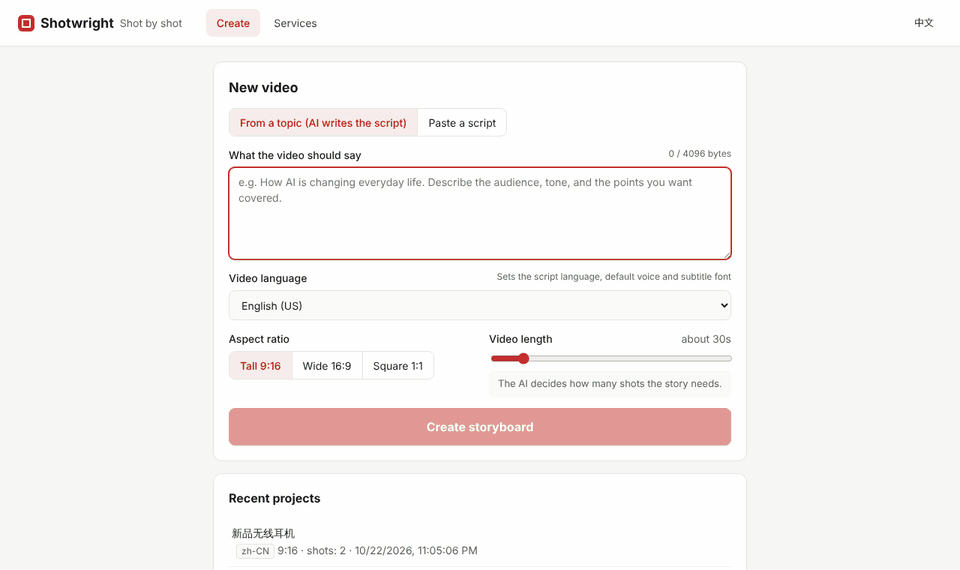
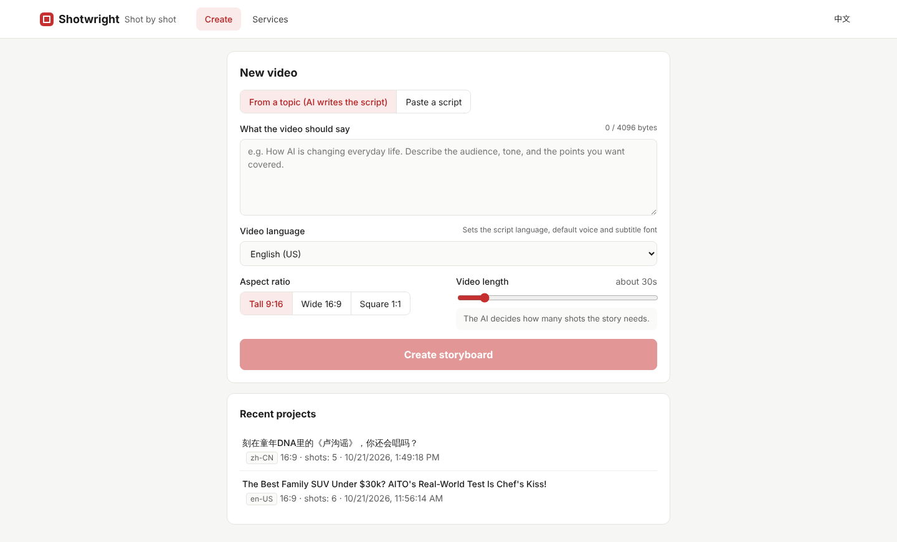
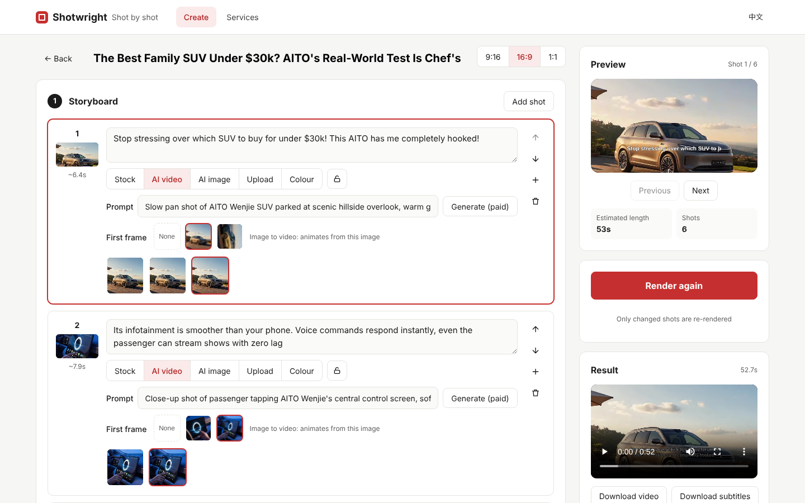
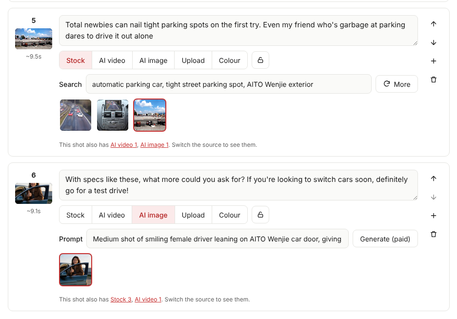
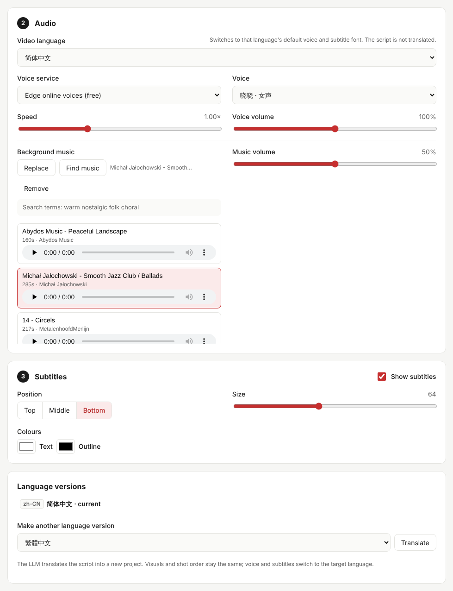
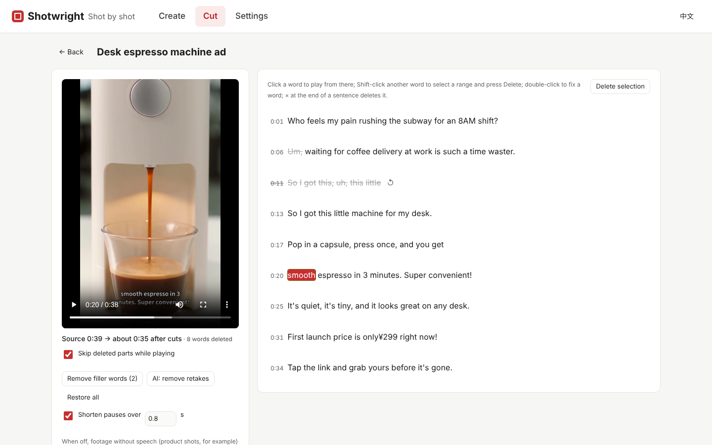
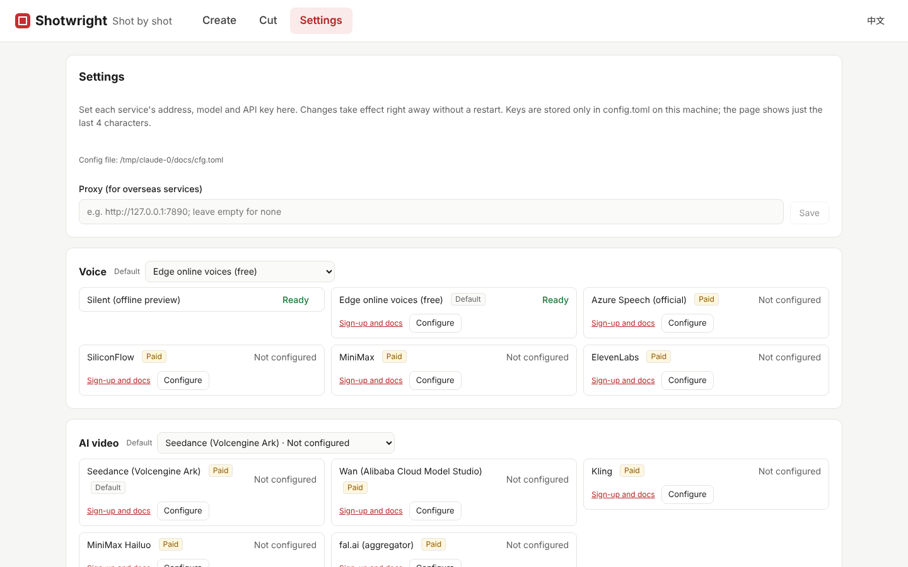

# Shotwright

[简体中文](README.md) | English

**One script, a set of ads ready to run.**

An open-source AI short-video tool that runs on your own machine: the script is split into shots, each shot picks its own visuals (stock, AI video, AI images or your own footage), and voice-over, subtitles and music are added automatically. Change a shot and only that shot is redone; risky prompts are flagged before you pay, every cost is visible, and language versions take one click.

Shotwright is built around the *shot*. The script is split into shots, and each shot picks its own visual source (stock search, AI generation, or your own uploaded image or video). Any shot can be replaced, locked or redone by itself. Change one shot and only that shot is re-rendered, plus the final assembly.

> Current version: v0.5.1. All v0.4 "product ads" and "video quality" features are built and being tested (editing a clip with a prompt needs a model that supports video-to-video, such as Seedance 2.5). In v0.5 "delivery and efficiency", the first-run wizard, configuring services in the UI, the extra AI video services, the Cut page, the review page, keyframes first by default, the pre-generation check, the free whole-cut preview, per-shot spend limits, brand packs and the subject library, the Windows installer (desktop window, mirror downloads for mainland China), the sample project and free text models (Zhipu GLM-4.7-Flash, local Ollama) are done; the rest is in progress. See the [roadmap](docs/ROADMAP.md).

**⬇️ One-click Windows install: [Download Shotwright-setup.exe](https://github.com/rushansishui/Shotwright/releases/latest/download/Shotwright-setup.exe)** (Windows 10 / 11 64-bit, just run it, nothing else to install) · [All releases](https://github.com/rushansishui/Shotwright/releases)

Slow download from mainland China? Try a mirror: [mirror 1](https://gh-proxy.com/https://github.com/rushansishui/Shotwright/releases/latest/download/Shotwright-setup.exe) · [mirror 2](https://ghfast.top/https://github.com/rushansishui/Shotwright/releases/latest/download/Shotwright-setup.exe) (third-party services; each release lists the SHA256 so you can verify the file). After installing, click "Open the sample project" to render a finished video without any API key.



<!-- Sample videos: put 2–3 finished videos made with Shotwright here (15–30 s, portrait, one Chinese and one English).
     Edit this file on GitHub, drag the mp4 into the editor to get a https://github.com/user-attachments/assets/... link,
     and put the link on its own line here; GitHub shows it as a player. -->
https://github.com/user-attachments/assets/d8ef5fab-29ec-41f6-8684-13e0af681cc6

https://github.com/user-attachments/assets/1cb4bd63-2a9d-4d7f-a122-a353b45b6013

**Change one shot, re-render one shot.** A 12-shot, 50-second video: **21 s** for the first full render, **11 s** after changing one line of copy — only **1 of 12** shots re-rendered, 22 of 26 render stages reused. That comes from the shot-level cache in the render engine, not from tuning. Numbers and the command to reproduce them: [BENCHMARK.md](BENCHMARK.md).

**Run it with one command:**

```bash
git clone https://github.com/rushansishui/Shotwright.git && cd Shotwright
pip install -e ".[dev]" && shotwright serve --open
```

It produces a video without any API key (sample project + free stock + Edge voice), so you can try it before configuring a model.

## How it compares

| | Shotwright | [ClipForge](https://github.com/xixihhhh/clipforge) | [OpenMontage](https://github.com/calesthio/OpenMontage) | [Pixelle-Video](https://github.com/AIDC-AI/Pixelle-Video) | [Creatify](https://creatify.ai/) | [LTX Studio](https://ltx.studio/) |
|---|---|---|---|---|---|---|
| What it is | Open source (MIT), runs locally | Open source (AGPL-3.0), runs locally, ~1.3k stars | Open source (AGPL-3.0), runs locally, ~72k stars | Open source (Apache 2.0), runs locally, ~30.1k stars | Online platform | Online platform |
| Best at | Product ads and promo shorts from a script; can also cut existing footage | Sales videos from a product image, or a video from one sentence | Explainers, documentary montages, talking heads and more, through a dozen pipelines | Topic in, script, images or AI video and a finished video out | Video ads from a product URL, AI actors, ad cloning | Script to storyboard to video, for ads and short films |
| Visuals | Stock, AI video, AI images or your own footage, chosen per shot | Free stock, a local library, AI images and video, 391 templates | Stock archives, AI video and images (cloud or local models), code-drawn graphics | Mostly AI images and video; you can also upload your own | AI actors and the platform's models | Models hosted on the platform |
| Models | Swap vendors for text, image, video and voice | 30+ curated models from several vendors | Many vendors plus local models | Many LLMs and voices; ComfyUI and RunningHub workflows | The platform's own and hosted models | The platform's own and hosted models |
| Changing one shot | Only that shot is redone, the rest reused | Every shot keeps its takes; redo just the bad one | Approve takes, prompts and cost per scene before rendering | — | — | Adjust shot by shot on the storyboard |
| Voice, subtitles, music to final cut | Automatic, in one flow | Automatic | Automatic | Automatic | Automatic | — |
| Before you pay | Flags prompts that tend to fail, shows each shot's estimated cost, per-shot spend limits | — | Budget cap and approval for costly steps | — | Cost shown before each generation | — |
| Language versions | One click, visuals shared | English voice-over versions | — | — | — | — |
| How you use it | Web UI, REST API, CLI, Windows installer | Web, desktop app, Docker, CLI, MCP | Driven by an AI coding assistant (Claude Code, Cursor, …) | Windows one-click package, Docker | In the browser | In the browser |
| Cost | Your own API keys, every charge logged | Your own API keys, or free stock and free voices only | Your own API keys or local models | Your own API keys or local ComfyUI | Subscription with monthly credits, free tier with watermark | Subscription |
| Projects and assets | On your machine | On your machine | On your machine | On your machine | On the platform | On the platform |

Which to pick: with only a product image and a need for many sales videos fast, ClipForge has lots of templates; if you already work in an AI coding assistant and want explainers or documentary-style videos, OpenMontage is powerful; for topic-to-video with AI images, look at Pixelle-Video; for hosted ads with AI actors, Creatify; for storyboarding films in the browser, LTX Studio. Chinese platforms such as [LibTV](https://liblib.tv/), [Jimeng](https://jimeng.jianying.com/) and [Jianying / CapCut](https://www.capcut.cn/), and open-source tools such as [MoneyPrinterTurbo](https://github.com/harry0703/MoneyPrinterTurbo) and [NarratoAI](https://github.com/linyqh/NarratoAI), are compared in the [Chinese README](README.md). To turn a script into ads ready to run, control every shot, know the cost before you pay, ship language versions in one click and keep projects in your own hands, use Shotwright.

<sub>Compiled from each project's home page, GitHub page and public coverage as of 16 November 2026; star counts are GitHub API snapshots for that day. "—" means no public information was found, not that the feature is missing. These products change quickly; if something is wrong, please open an issue.</sub>

## Core capabilities

- **Shot-level control**: every shot picks its own visual source (stock / AI video / AI images / upload / solid colour) and can be replaced, locked or redone on its own. Change one shot and only that shot is re-rendered.
- **Know the cost before you pay**: pre-generation checks, a free draft preview of the whole cut, per-shot spend limits, a cost estimate before rendering, and a receipt afterwards — cost per finished second, first-pass rate, retakes, wasted money.
- **Real footage and AI, mixed**: stock, generated visuals and your own footage in one video; import footage split by scene changes, or cut a talking-head video by its transcript (local speech recognition, the file never leaves your machine).
- **Language versions in one click**: the same visuals, with copy, voice-over and subtitles translated into 16 languages.
- **Model-neutral**: swap vendors for text, image, video and voice, with your own keys; nothing is locked to one provider.
- **Local and open**: MIT, projects, assets and logs stay on your machine, and it runs without any API key.

Full feature list (30 items, with edge cases) in [docs/FEATURES.en.md](docs/FEATURES.en.md).
## Screenshots

**Create a new video**: describe the idea in a few sentences, the AI turns it into a full brief from the template for the video type, then writes an editable script, and the storyboard is generated from that script; your projects are listed on the right.



**Storyboard editor**: five steps in production order — ① Materials (subject reference images and looks, brand and style references) → ② Visuals → ③ Voice & subtitles → ④ Music & SFX → ⑤ Titles & text. AI visuals can only be generated once every subject has its reference images and look and the checklist is confirmed. Each shot picks its own visual source; the live preview on the right shows the subtitles, and only changed shots are re-rendered.



**Shot card**: every shot picks its own visual source (stock, AI video, AI image, upload, solid colour), and one video can mix them; AI video prompts are built from the shared look, you can draft keyframes first, generate several takes at once and pick draft or final resolution, and every generation is kept as a version; shot type, caption title, camera move and AI rewrite sit under "More".



**Audio, subtitles and language versions**: switch the video language and voice; upload background music or find it automatically and preview the candidates; translate the video into another language in one click.



**Cut an existing video**: with "Edit by what is said", click a word to play from there; struck-through words are deleted fillers and retakes and are skipped during playback; then generate original-sound shots. For footage without speech, "Edit by scenes" splits it into shots directly.



**Settings**: fill in each service's key, model and endpoint in the page; saving writes back to `config.toml` and takes effect immediately, keys are shown only as their last four characters, and LLMs, AI video and speech recognition have a "Test connection" button.



## Hardware requirements

Script writing, AI video / images and voice-over all run in the cloud; your machine only edits and encodes with FFmpeg, so **no GPU is needed**.

| | Minimum | Recommended |
| --- | --- | --- |
| CPU | 2 cores (x86-64 or ARM64) | 4 cores or more |
| Memory | 2 GB free | 8 GB |
| Disk | 2 GB free for the app and dependencies, plus about 0.5 GB per project | 20 GB+ SSD |
| Network | Needed for AI, voice-over and stock search; offline mode works without it | Stable broadband for faster 1080p downloads |
| OS | Windows 10 / 11, macOS 12+, mainstream Linux | |

Measured on a 2-core Linux VM with 7 GB of RAM: a 6-shot, 52.7-second 1080p landscape video took about 2 minutes to render from scratch, with the server and FFmpeg peaking below 500 MB of memory combined. Changing a single shot only redoes that shot, the assembly and the subtitle pass, about 1 minute there (the subtitle pass re-encodes the whole video). On the Windows desktop used for development, the same single-shot re-render measured 4–10 seconds; more CPU cores make it faster.

Most disk space goes to assets: projects using AI video and 1080p stock footage measured 100–600 MB each, and each finished render takes about 15–20 MB per minute of video. The render cache under `cache/` can be deleted at any time.

## Quick start

**Windows installer**: [download the latest Shotwright-setup.exe](https://github.com/rushansishui/Shotwright/releases/latest/download/Shotwright-setup.exe) (or the versioned `Shotwright-<version>-setup.exe` from the [Releases](https://github.com/rushansishui/Shotwright/releases/latest) page) and run it. No admin rights needed, and no separate Python, Node.js or FFmpeg install (they are bundled). Open it from the Start menu or desktop icon: the app opens in its own desktop window (using the system WebView2, built into Windows 11 and installed with Edge on Windows 10); closing the window stops the server. Without WebView2 it falls back to your browser. To use your own browser, open "Shotwright (Browser)" from the Start menu. Settings, projects and logs live in `%LOCALAPPDATA%\Shotwright` (“Shotwright Data” in the Start menu) and survive uninstalls and upgrades. If something goes wrong, run `Shotwright.exe doctor` in a terminal to check the environment.

> The installer is not code-signed yet, so Windows may show "Windows protected your PC". Click "More info" → "Run anyway".

Publishing a release (maintainers): set the same new version in `pyproject.toml` and `web/package.json` and push to `main`, then `git tag v<version>` and `git push origin v<version>`. GitHub Actions checks that the tag and both version numbers match, then builds and tests the installer and attaches it to the Release; the download link above always points to the newest one.

To build it yourself, run `powershell -ExecutionPolicy Bypass -File scripts\build-installer.ps1` from the repository root (needs Python 3.11+, Node.js 20+ and [Inno Setup 6.5+](https://jrsoftware.org/isdl.php); a pinned FFmpeg version is downloaded and checksum-verified automatically). The installer lands in `dist\installer\`.

**Windows from source**: install Python 3.11+, FFmpeg and Node.js (`start.bat` prints the `winget` command for anything missing), then double-click `start.bat`. The first run creates a virtual environment, installs dependencies, builds the web UI and opens your browser.

**Works without any key**: the home page shows a “Before you start” guide. Pick any supported text model (Doubao, DeepSeek, Kimi, Qwen or any OpenAI-compatible API) and paste its key, or try it free first: write your own script with free Edge voices, subtitles and your own photos or clips, or cut an existing video (local speech recognition). Without a stock key, footage search falls back to the keyless Coverr.

For a manual install you need Python 3.11+, [FFmpeg](https://ffmpeg.org/download.html) (with libass, which most builds include) and Node.js 20+ (only for building the web UI).

```bash
# 1. Install the backend
python -m venv .venv
.venv\Scripts\activate          # macOS / Linux: source .venv/bin/activate
pip install -e ".[dev,asr]"   # asr: local speech recognition for the Cut page (faster-whisper); drop it if you won't use Cut

# 2. Configure (optional): copy the template and fill in Pixabay and LLM API keys
copy config.example.toml config.toml   # macOS / Linux: cp

# 3. Build the web UI
cd web && npm install && npm run build && cd ..

# 4. Start
shotwright serve
```

Then open <http://127.0.0.1:8000>. On Windows you can simply double-click `start.bat` to start and `restart.bat` to restart (it first stops the old server on port 8000). For frontend development, run `cd web && npm run dev` in another terminal and visit <http://localhost:5173>.

### Docker

```bash
mkdir docker-data && cp config.example.toml docker-data/config.toml   # fill in keys as needed
docker compose up -d --build
```

Then open <http://127.0.0.1:8000>. Projects and renders are kept in `docker-data/`. The server only accepts requests addressed to the local machine; to use it over your LAN, add the server's IP to `allowed_hosts` under `[app]` in `config.toml` and change the port mapping in `docker-compose.yml` to `"8000:8000"`.

### Command line

```bash
shotwright new --script-file script.txt --aspect 9:16      # split a script into shots
shotwright new --subject "How AI is changing daily life" --llm --language en-US --duration 45
                                                          # LLM writes a ~45 s English script and storyboard
shotwright show <project-id>
shotwright shot <project-id> 2 --text "New line" --terms "city night,traffic"
shotwright render <project-id>                            # only redo shots that changed
shotwright render <project-id> --allow-paid               # allow paid AI generation for shots missing visuals
shotwright translate <project-id> ja-JP                   # create a Japanese version (new project, shared visuals)
shotwright copy <project-id>                              # duplicate into a new project to keep editing
shotwright spend <project-id>                             # cost receipt: what each shot cost, which takes were wasted
shotwright bench                                          # run the quality benchmark, compared with the last batch
shotwright bench --local                                  # local render benchmark: offline, free, how long one shot change takes
```

## Configuration

The easiest way is the **Settings** page in the web UI: each service's key, model and endpoint can be edited there, and saving writes back to `config.toml` and takes effect immediately without a restart; LLM and AI video services also have a one-click **Test connection** to check the key, endpoint and model name. Keys are shown only as their last four characters.

You can also edit the config file directly, see [config.example.toml](config.example.toml) (comments are in Chinese; a restart is needed). Every provider field can also be overridden with an environment variable named `SHOTWRIGHT_<KIND>_<ID>_<FIELD>`, for example:

```bash
SHOTWRIGHT_STOCK_PIXABAY_API_KEY=xxxx
SHOTWRIGHT_DEFAULT_LLM=deepseek
SHOTWRIGHT_LLM_DEEPSEEK_API_KEY=sk-xxxx
```

Four LLM presets are built in: Doubao Seed, DeepSeek, Kimi and Qwen. Pick one and fill in its API key. Any other OpenAI-compatible API can be set up in the `openai` section with your own base URL and model.

Voice-over uses the free, key-less Edge voices by default. For steadier quality or clearer commercial licensing, set `tts` under `[defaults]` to `azure`, `siliconflow`, `minimax` or `elevenlabs` and fill in the API key in that section. These four are paid services and are marked as such in the UI.

Stock footage uses Pixabay by default (free key); without a key it falls back to the keyless Coverr (mostly landscape). Pexels needs your own key. Every service on the Services page explains how to get it: where to sign up, which key to copy, what to enable and how it is billed.

Speech recognition for the Cut page uses local `faster_whisper` by default: it needs no network, costs nothing and the footage never leaves the machine. The first run downloads a model (about 480 MB for `small`); if Hugging Face is unreachable it switches to the hf-mirror.com mirror automatically. To use a cloud service instead, set `asr` under `[defaults]` to `openai` and fill in `[providers.asr.openai]` — any OpenAI-compatible `/audio/transcriptions` endpoint that returns word timestamps works (OpenAI `whisper-1`, Groq `whisper-large-v3-turbo`, …), with a 25 MB limit per file.

Background music search uses Internet Archive by default and needs no key. **Licences on Internet Archive vary**: some tracks forbid commercial use or adaptation (for example CC BY-NC-ND), and some carry no licence at all. Results are classified by licence and non-commercial tracks are skipped; tracks with no stated licence are kept by default and flagged in the UI, so check before you publish. To be stricter, set `allow_unknown_license` to `"false"` under `[providers.music.archive]` to keep only clearly commercial-friendly licences (CC0 / public domain / CC BY / CC BY-SA), restrict the search to a collection with clear licences via `collection`, or upload your own music.

AI video (Seedance) and AI images (Seedream) run on Volcengine Ark, the same platform as Doubao. Once the key in `[providers.llm.doubao]` is filled in and the models are enabled in the Ark console, they work without entering the key again.

Other AI video services (Wan, Kling, MiniMax Hailuo, fal.ai) each have a section in `config.toml`; see `config.example.toml`. With more than one configured, a "Video model" picker appears next to each shot's prompt so you can generate the same shot with different models and compare. Models that accept reference images (Seedance 2.x, Wan 3.0, MiniMax H3) get the product photos as references; the others use the first product photo as the first frame. Prices are estimates; set `price` to your account's actual rate per second for accurate cost estimates and budgets.

Keys live only in the config file or environment variables and are never written into project files, so projects are safe to share.

## Documentation

These documents are currently in Chinese.

- [Architecture](docs/ARCHITECTURE.md): layers, data model, render pipeline, provider plugins
- [Render benchmark](BENCHMARK.md): measured cost of changing one shot, and how to reproduce it
- [Full feature list](docs/FEATURES.en.md): details and edge cases for all 30 features
- [Contributing](CONTRIBUTING.md): setup, tests, change rules
- [Roadmap](docs/ROADMAP.md)
- [Porting notes from MoneyPrinterTurbo](docs/PORTING.md)
- [Adding a provider](docs/PROVIDERS.md)

## Development scripts

Everything under `scripts/` is a helper for working on Shotwright, not shipped with the installer:

- `scripts/promo/`: builds the promo video in one command. It copies a finished demo project, creates a 16:9 project holding the voice-over, then drives the UI with Playwright and records it (buttons that cost money are only hovered, never clicked). Each recording is trimmed to the narration length, long waits are cut, and the clips go back into the shots before the final render. Edit the storyboard and script in `storyboard.py`. Install the extras first: `pip install -e ".[promo]" && python -m playwright install chromium`, then run `python scripts/promo/make_promo.py --demo <project id> --lang en`.
- `scripts/build-installer.ps1`: builds the Windows installer (see Quick start).

## Acknowledgements

Shotwright is written from scratch. Some of its design and implementation draw on [MoneyPrinterTurbo](https://github.com/harry0703/MoneyPrinterTurbo) (MIT License, © 2024 Harry); see [NOTICE.md](NOTICE.md) for details.

## License

[MIT](LICENSE). The bundled Noto Sans SC / KR / Thai fonts are licensed under the SIL Open Font License 1.1 (see [resources/fonts](resources/fonts)).

