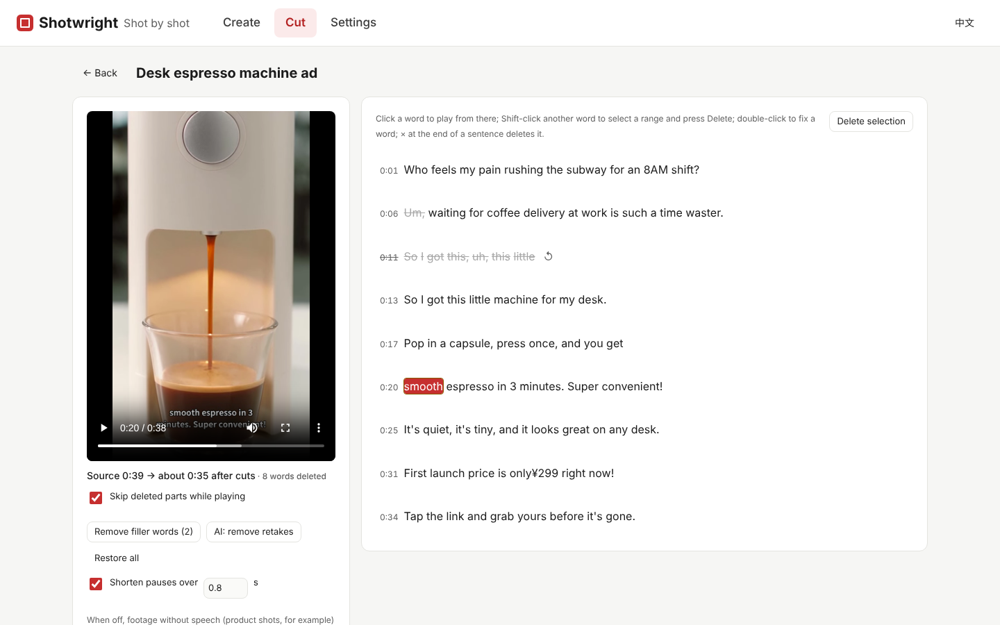
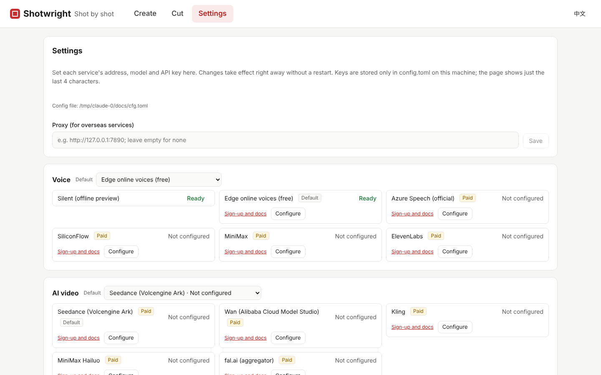

# Shotwright

[简体中文](README.md) | English

**From a video brief to a finished video: AI writes the script, each shot gets generated or stock footage, voice-over, subtitles and background music are added automatically, and every shot can be adjusted on its own.**

Shotwright is built around the *shot*. The script is split into shots, and each shot picks its own visual source (stock search, AI generation, or your own uploaded image or video). Any shot can be replaced, locked or redone by itself. Change one shot and only that shot is re-rendered, plus the final assembly.

> Current version: v0.4.0. All v0.4 "product ads" and "video quality" features are built and being tested (editing a clip with a prompt needs Seedance 2.5 enabled on Volcengine Ark). In v0.5 "delivery and efficiency", the first-run wizard, configuring services in the UI, the extra AI video services, the Cut page, the review page, keyframes first by default, the pre-generation check and the Windows installer are done; the rest is in progress. See the [roadmap](docs/ROADMAP.md).


## Features

- **Consistent people and products**: in the look, every subject can take uploaded photos, or have AI paint a plain-background reference portrait from its appearance description; those images are sent as references when generating AI video and images, so it is the same person and the same product in every shot. When one product comes in several colours, label each image: a shot uses only the main image by default (so the model is never handed several colours at once), and you can pick which variant a single shot uses; the prompt then demands the colour match the reference exactly. If a shot names several colours (four kids each in a different one), those variants are sent along. "Describe from images" reads the collar, hood or no hood, zips, pockets and seams off the photos, and the prompt insists the construction follows the reference instead of the model inventing a hood. Shots that show a subject default to AI generation, and the pre-render check flags subjects without a reference image and shots that show a subject but use stock footage.
- **Guided creation**: start with a few sentences about your idea, and AI turns them into a full brief using the template for the chosen video type (facts it cannot know become "[to be added]", for you to fill in); then it writes a paragraph-by-paragraph voice-over script you can edit, reorder, add to or trim; the storyboard is finally written from that final script with the wording kept word for word. The original idea, the brief and the storyboard script are kept on the project as a "creation record" you can read, copy, or use to start a new video from: back to the new-video page with all of it loaded, edit, and generate a new video. Media can be uploaded at the same time: product and people photos go into the look's subject images, logos and style images into the references, clips straight into shots, and audio becomes the background music.
- **Storyboard editing**: split a script into shots sentence by sentence, or write a video brief (audience, tone, key points; up to 4096 bytes), pick a length, and let an LLM write the script, decide how many shots it needs, and suggest search terms and visual prompts for each shot. An existing video can be **duplicated into a new project** to keep editing, carrying its assets, settings and render cache along.
- **Mixed visuals**: in one video, some shots can use Pixabay / Pexels / Coverr footage, some AI video (Seedance, Wan, Kling, MiniMax Hailuo, or Veo, Vidu and others via fal.ai, chosen per shot) or AI images (Seedream with a slow Ken Burns push-in), and some your own uploads. An AI image can also serve as the first frame of an AI video. A shot can hold **several clips played in sequence**, and candidates can be deleted. Under each shot, a hint shows how many candidates the other sources have, with one click to switch, so switching sources never loses footage you already generated.
- **Footage import and in-shot editing**: import footage shot on a phone and have it split into shots at scene changes; in each shot you can drag the in and out points, split it or merge it with the next. When a clip is shorter than its shot it is slowed down a little (to no less than 0.8×) and then holds its last frame, instead of jumping back to the start. The clip's own sound can be kept at an adjustable volume and is lowered automatically under the voice-over. When switching between portrait and landscape you can choose what part of the frame to keep, or keep the whole subject over a blurred fill.
- **Cut an existing video**: "Cut" in the top bar is separate from "Create" and has its own task list. There are two ways to cut: for footage without speech (product shots, b-roll, montage material) choose "Edit by scenes", which skips speech recognition and splits the video at scene changes, several videos at a time; for talking-head, explainer and live-selling videos choose "Edit by what is said": upload the video and it transcribes what is said (local faster-whisper — free, and the footage never leaves your machine — or an OpenAI-compatible cloud service), with progress shown while the model downloads and while it transcribes. Click a word to jump and play, select a passage and delete it to cut the video with it; one click ticks off filler words (um, uh, 嗯, 啊), "AI retakes" finds sentences that were restarted or abandoned halfway, and long pauses can be squeezed. Double-click to fix a mis-transcribed word. Generate original-sound shots from the result: no re-voicing, subtitles follow the word timings, the removed parts are skipped inside each shot, and subtitles, music, titles and translated voice-over versions all work as usual.
- **Video quality**: pick a video type on the home page (product ad, brand film, explainer, talking head, footage makeover) to get a brief template and writing tips, with a check for unfilled placeholders before you submit. The storyboard starts with a look (subject appearance, setting, style, taboos, color grade); every shot gets a 60–120-word description, a camera move and a continuity note, and the storyboard is self-checked and rewritten once if needed. At generation time you can create keyframes first, several takes at once, or extend shots longer than the model allows from the last frame. With a vision model configured, results are checked for product drift, stock candidates are ranked and the final video is scanned for flaws. A pre-render check lists things worth fixing, and `shotwright bench` runs a fixed quality benchmark compared with the previous batch.
- **Finishing**: export normalizes loudness to -14 LUFS and ducks the music under the voice with a fade in and out. Optionally cuts snap to the music's beat, transition whooshes and ambience can be layered in, the whole video can share one color grade, and delivery targets (Douyin, Kuaishou, Channels, Xiaohongshu, Shorts, Bilibili) set the encoding and keep subtitles and overlays inside the safe area.
- **Product ads**: a project-level library of product shots, people, logos and style images used as references for generation; edit a clip with a prompt (video-to-video); overlay selling points, prices and logos separately from the subtitles, with transitions between shots; overlay text is translated along with the language versions.
- **Charge confirmation**: every paid generation must be confirmed in the UI before it is submitted. If the result of a submission can't be confirmed, it is never retried automatically, so you are never charged twice.
- **Generate all and review**: in the Visuals step, one click generates every AI shot that has no picture yet: it first lists each shot's reference cost and the total, then queues them in the background, and you can stop at any time. **Review** puts every shot's candidate versions on one page: click to use one, mark each shot OK or Redo with a short note, then regenerate all the redo shots at once (with a text model configured, the shot description is first rewritten from your note).
- **Incremental rendering**: each stage is fingerprinted by its inputs and cached, so unchanged shots are reused. Renders can be cancelled at any time. A draft quality renders faster for a first look; the estimated cost is shown before rendering and the project keeps a running total of generation spend.
- **AI content labels**: the MP4 metadata of every render marks it as AI-generated and credits CC BY background music; an optional "AI" badge can be shown on screen.
- **Voice-over**: free Edge online voices by default, with Azure, SiliconFlow, MiniMax and ElevenLabs available as alternatives you can switch between in the UI.
- **Subtitles**: wrapped by real font width with balanced line lengths. Edge returns per-word timings, so subtitles follow the actual speech; for providers that return no timings, cues fall back to proportional time allocation.
- **Pronunciation fixes**: when a voice reads a polyphonic character or a slang term wrong (for example 打的), the word is swapped for a homophone before synthesis while the subtitle keeps the original text. You can audition the result, or let an LLM scan the whole script for words that are easy to misread; common cases are built in.
- **Titles**: a persistent headline at the top of the frame, an intro title card (dims the picture, shows a title and subtitle centred, then fades out), and a per-shot small title — each styled independently. An LLM can also suggest a few candidate titles from the script, one click to use.
- **Text styling**: subtitles and titles can each set font, bold, italic, underline, alignment, outline (with an optional second outline), shadow (distance, direction, blur), background box, glow, letter spacing, line spacing and opacity, plus entrance animations (fade, pop, slide up, typewriter, karaoke word-by-word highlight), exit animations (fade out, shrink away, slide down and fade) and loop animations (breathing scale, side-to-side sway). Subtitles can also highlight keywords in another colour and size (typed in, or picked by an LLM from the script). Built-in presets include classic white, variety yellow, black-on-white, news bar, neon glow, double outline, 3D shadow and soft dreamy. Bundled fonts are Noto Sans SC (regular / bold), Noto Serif SC, ZCOOL KuaiLe, ZCOOL QingKe HuangYou and Ma Shan Zheng; you can also import your own licensed fonts.
- **Background music**: upload your own (an mp4/m4a with cover art works directly as music), or find it in one click: an LLM turns the brief and the shots into music-style search terms, candidates come from Internet Archive (no key needed) and are filtered by licence, you can preview and switch them, and the track loops to the length of the video. Cuts can optionally snap to the music's beat, and transition whooshes plus ambience can be layered in.
- **Stock search cache**: the same search term reuses its previous results for 7 days instead of querying the library again.
- **Three ways in**: web UI, REST API (`/api/v2`) and CLI, all sharing the same services and render queue. Error messages come back in Chinese or English based on the request language.
- **Multilingual**: videos can be in 16 languages, including Chinese, English, Japanese, Korean and Spanish, with a matching voice and subtitle font picked automatically. One click translates a video into another language version (visuals are shared; only the script, voice and subtitles change). The web UI switches between 中文 and English.
- **Assets sorted by source**: project assets live in `ai-video`, `ai-image`, `stock`, `upload`, `music` and similar folders; older projects are sorted automatically at startup.
- **Logs**: `storage/logs/shotwright.log` records the model, task id and result of every paid task, plus each generation and render. Logs rotate daily, are kept for 14 days, and API keys are masked.
- **Works offline**: with no services configured it still runs end to end (silent voice-over and solid-color frames), handy for tuning storyboard pacing first.

## Screenshots

**Create a new video**: describe the idea in a few sentences, the AI turns it into a full brief from the template for the video type, then writes an editable script, and the storyboard is generated from that script; your projects are listed on the right.


**Storyboard editor**: five steps in production order — ① Materials (subject reference images and looks, brand and style references) → ② Visuals → ③ Voice & subtitles → ④ Music & SFX → ⑤ Titles & text. AI visuals can only be generated once every subject has its reference images and look and the checklist is confirmed. Each shot picks its own visual source; the live preview on the right shows the subtitles, and only changed shots are re-rendered.


**Shot card**: every shot picks its own visual source (stock, AI video, AI image, upload, solid colour), and one video can mix them; AI video prompts are built from the shared look, you can draft keyframes first, generate several takes at once and pick draft or final resolution, and every generation is kept as a version; shot type, caption title, camera move and AI rewrite sit under "More".


**Audio, subtitles and language versions**: switch the video language and voice; upload background music or find it automatically and preview the candidates; translate the video into another language in one click.


**Cut an existing video**: with "Edit by what is said", click a word to play from there; struck-through words are deleted fillers and retakes and are skipped during playback; then generate original-sound shots. For footage without speech, "Edit by scenes" splits it into shots directly.



**Settings**: fill in each service's key, model and endpoint in the page; saving writes back to `config.toml` and takes effect immediately, keys are shown only as their last four characters, and LLMs, AI video and speech recognition have a "Test connection" button.



## Hardware requirements

Script writing, AI video / images and voice-over all run in the cloud; your machine only edits and encodes with FFmpeg, so **no GPU is needed**.

| | Minimum | Recommended |
| --- | --- | --- |
| CPU | 2 cores (x86-64 or ARM64) | 4 cores or more |
| Memory | 2 GB free | 8 GB |
| Disk | 2 GB free for the app and dependencies, plus about 0.5 GB per project | 20 GB+ SSD |
| Network | Needed for AI, voice-over and stock search; offline mode works without it | Stable broadband for faster 1080p downloads |
| OS | Windows 10 / 11, macOS 12+, mainstream Linux | |

Measured on a 2-core Linux VM with 7 GB of RAM: a 6-shot, 52.7-second 1080p landscape video took about 2 minutes to render from scratch, with the server and FFmpeg peaking below 500 MB of memory combined. Changing a single shot only redoes that shot, the assembly and the subtitle pass, about 1 minute there (the subtitle pass re-encodes the whole video). On the Windows desktop used for development, the same single-shot re-render measured 4–10 seconds; more CPU cores make it faster.

Most disk space goes to assets: projects using AI video and 1080p stock footage measured 100–600 MB each, and each finished render takes about 15–20 MB per minute of video. The render cache under `cache/` can be deleted at any time.

## Quick start

**Windows installer**: download `Shotwright-<version>-setup.exe` and run it. No admin rights needed, and no separate Python, Node.js or FFmpeg install (they are bundled). Open it from the Start menu or desktop icon: a server window appears and your browser opens; closing the window stops the server. Settings, projects and logs live in `%LOCALAPPDATA%\Shotwright` (“Shotwright Data” in the Start menu) and survive uninstalls and upgrades. If something goes wrong, run `Shotwright.exe doctor` in a terminal to check the environment.

To build it yourself, run `powershell -ExecutionPolicy Bypass -File scripts\build-installer.ps1` from the repository root (needs Python 3.11+, Node.js 20+ and [Inno Setup 6](https://jrsoftware.org/isdl.php); FFmpeg is downloaded automatically). The installer lands in `dist\installer\`.

**Windows from source**: install Python 3.11+, FFmpeg and Node.js (`start.bat` prints the `winget` command for anything missing), then double-click `start.bat`. The first run creates a virtual environment, installs dependencies, builds the web UI and opens your browser.

**Works without any key**: the home page shows a “Before you start” guide. Pick any supported text model (Doubao, DeepSeek, Kimi, Qwen or any OpenAI-compatible API) and paste its key, or try it free first: write your own script with free Edge voices, subtitles and your own photos or clips, or cut an existing video (local speech recognition). Without a stock key, footage search falls back to the keyless Coverr.

For a manual install you need Python 3.11+, [FFmpeg](https://ffmpeg.org/download.html) (with libass, which most builds include) and Node.js 20+ (only for building the web UI).

```bash
# 1. Install the backend
python -m venv .venv
.venv\Scripts\activate          # macOS / Linux: source .venv/bin/activate
pip install -e ".[dev,asr]"   # asr: local speech recognition for the Cut page (faster-whisper); drop it if you won't use Cut

# 2. Configure (optional): copy the template and fill in Pixabay and LLM API keys
copy config.example.toml config.toml   # macOS / Linux: cp

# 3. Build the web UI
cd web && npm install && npm run build && cd ..

# 4. Start
shotwright serve
```

Then open <http://127.0.0.1:8000>. On Windows you can simply double-click `start.bat` to start and `restart.bat` to restart (it first stops the old server on port 8000). For frontend development, run `cd web && npm run dev` in another terminal and visit <http://localhost:5173>.

### Docker

```bash
mkdir docker-data && cp config.example.toml docker-data/config.toml   # fill in keys as needed
docker compose up -d --build
```

Then open <http://127.0.0.1:8000>. Projects and renders are kept in `docker-data/`. The server only accepts requests addressed to the local machine; to use it over your LAN, add the server's IP to `allowed_hosts` under `[app]` in `config.toml` and change the port mapping in `docker-compose.yml` to `"8000:8000"`.

### Command line

```bash
shotwright new --script-file script.txt --aspect 9:16      # split a script into shots
shotwright new --subject "How AI is changing daily life" --llm --language en-US --duration 45
                                                          # LLM writes a ~45 s English script and storyboard
shotwright show <project-id>
shotwright shot <project-id> 2 --text "New line" --terms "city night,traffic"
shotwright render <project-id>                            # only redo shots that changed
shotwright render <project-id> --allow-paid               # allow paid AI generation for shots missing visuals
shotwright translate <project-id> ja-JP                   # create a Japanese version (new project, shared visuals)
shotwright copy <project-id>                              # duplicate into a new project to keep editing
shotwright bench                                          # run the quality benchmark, compared with the last batch
```

## Configuration

The easiest way is the **Settings** page in the web UI: each service's key, model and endpoint can be edited there, and saving writes back to `config.toml` and takes effect immediately without a restart; LLM and AI video services also have a one-click **Test connection** to check the key, endpoint and model name. Keys are shown only as their last four characters.

You can also edit the config file directly, see [config.example.toml](config.example.toml) (comments are in Chinese; a restart is needed). Every provider field can also be overridden with an environment variable named `SHOTWRIGHT_<KIND>_<ID>_<FIELD>`, for example:

```bash
SHOTWRIGHT_STOCK_PIXABAY_API_KEY=xxxx
SHOTWRIGHT_DEFAULT_LLM=deepseek
SHOTWRIGHT_LLM_DEEPSEEK_API_KEY=sk-xxxx
```

Four LLM presets are built in: Doubao Seed, DeepSeek, Kimi and Qwen. Pick one and fill in its API key. Any other OpenAI-compatible API can be set up in the `openai` section with your own base URL and model.

Voice-over uses the free, key-less Edge voices by default. For steadier quality or clearer commercial licensing, set `tts` under `[defaults]` to `azure`, `siliconflow`, `minimax` or `elevenlabs` and fill in the API key in that section. These four are paid services and are marked as such in the UI.

Stock footage uses Pixabay by default (free key); without a key it falls back to the keyless Coverr (mostly landscape). Pexels needs your own key. Every service on the Services page explains how to get it: where to sign up, which key to copy, what to enable and how it is billed.

Speech recognition for the Cut page uses local `faster_whisper` by default: it needs no network, costs nothing and the footage never leaves the machine. The first run downloads a model (about 480 MB for `small`); if Hugging Face is unreachable it switches to the hf-mirror.com mirror automatically. To use a cloud service instead, set `asr` under `[defaults]` to `openai` and fill in `[providers.asr.openai]` — any OpenAI-compatible `/audio/transcriptions` endpoint that returns word timestamps works (OpenAI `whisper-1`, Groq `whisper-large-v3-turbo`, …), with a 25 MB limit per file.

Background music search uses Internet Archive by default and needs no key. **Licences on Internet Archive vary**: some tracks forbid commercial use or adaptation (for example CC BY-NC-ND), and some carry no licence at all. Results are classified by licence and non-commercial tracks are skipped; tracks with no stated licence are kept by default and flagged in the UI, so check before you publish. To be stricter, set `allow_unknown_license` to `"false"` under `[providers.music.archive]` to keep only clearly commercial-friendly licences (CC0 / public domain / CC BY / CC BY-SA), restrict the search to a collection with clear licences via `collection`, or upload your own music.

AI video (Seedance) and AI images (Seedream) run on Volcengine Ark, the same platform as Doubao. Once the key in `[providers.llm.doubao]` is filled in and the models are enabled in the Ark console, they work without entering the key again.

Other AI video services (Wan, Kling, MiniMax Hailuo, fal.ai) each have a section in `config.toml`; see `config.example.toml`. With more than one configured, a "Video model" picker appears next to each shot's prompt so you can generate the same shot with different models and compare. Models that accept reference images (Seedance 2.x, Wan 3.0, MiniMax H3) get the product photos as references; the others use the first product photo as the first frame. Prices are estimates; set `price` to your account's actual rate per second for accurate cost estimates and budgets.

Keys live only in the config file or environment variables and are never written into project files, so projects are safe to share.

## Documentation

These documents are currently in Chinese.

- [Architecture](docs/ARCHITECTURE.md): layers, data model, render pipeline, provider plugins
- [Roadmap](docs/ROADMAP.md)
- [Porting notes from MoneyPrinterTurbo](docs/PORTING.md)
- [Adding a provider](docs/PROVIDERS.md)

## Acknowledgements

Shotwright is written from scratch. Some of its design and implementation draw on [MoneyPrinterTurbo](https://github.com/harry0703/MoneyPrinterTurbo) (MIT License, © 2024 Harry); see [NOTICE.md](NOTICE.md) for details.

## License

[MIT](LICENSE). The bundled Noto Sans SC / KR / Thai fonts are licensed under the SIL Open Font License 1.1 (see [resources/fonts](resources/fonts)).
