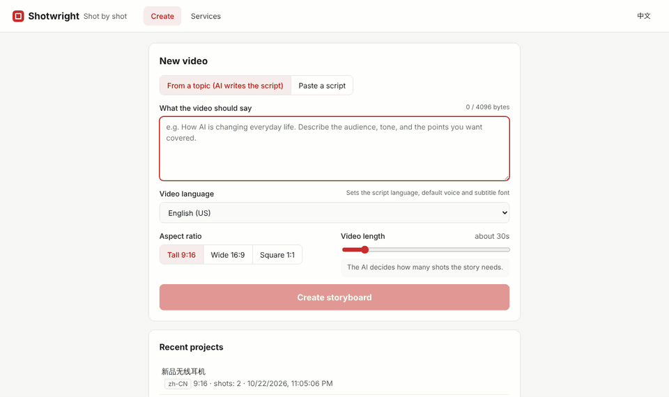
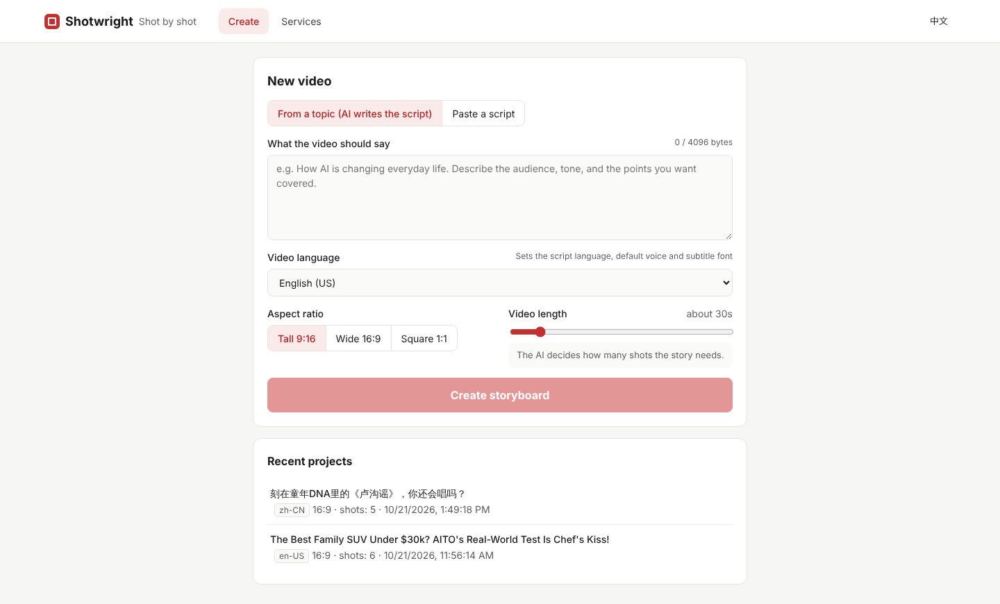
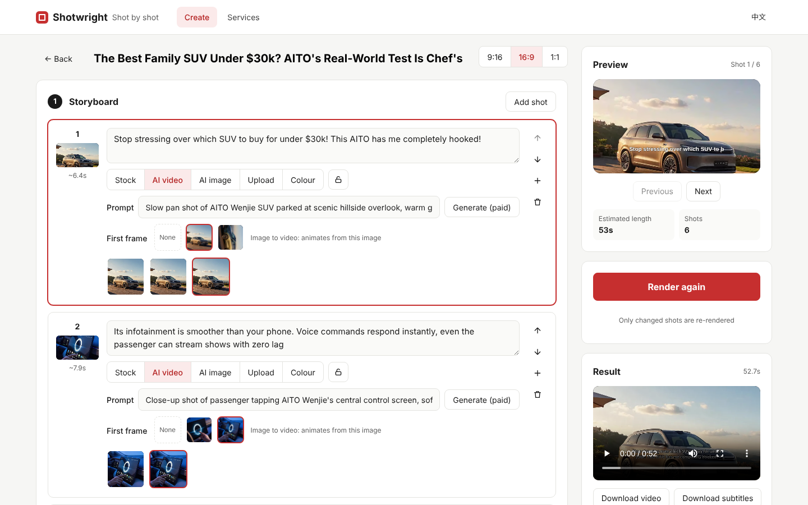
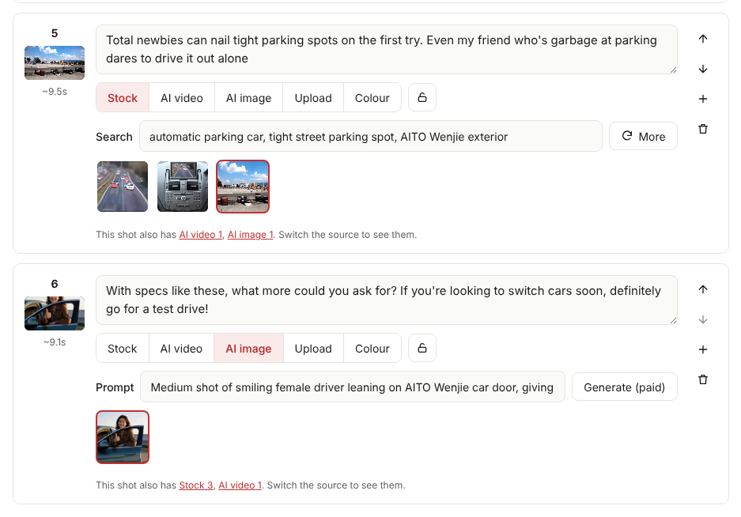
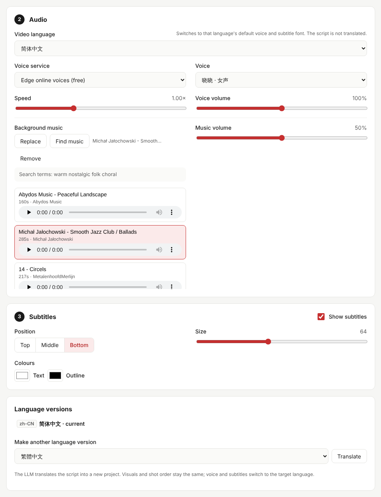

# Shotwright

[简体中文](README.md) | English

**From a video brief to a finished video: AI writes the script, each shot gets generated or stock footage, voice-over, subtitles and background music are added automatically, and every shot can be adjusted on its own.**

Shotwright is built around the *shot*. The script is split into shots, and each shot picks its own visual source (stock search, AI generation, or your own uploaded image or video). Any shot can be replaced, locked or redone by itself. Change one shot and only that shot is re-rendered, plus the final assembly.

> Current version: v0.3.0. All v0.4 "product ads" features are built and being tested (editing a clip with a prompt needs Seedance 2.5 enabled on Volcengine Ark). See the [roadmap](docs/ROADMAP.md).



## Features

- **Storyboard editing**: split a script into shots sentence by sentence, or write a video brief (audience, tone, key points; up to 4096 bytes), pick a length, and let an LLM write the script, decide how many shots it needs, and suggest search terms and visual prompts for each shot.
- **Mixed visuals**: in one video, some shots can use Pixabay / Pexels / Coverr footage, some AI video (Seedance) or AI images (Seedream with a slow Ken Burns push-in), and some your own uploads. An AI image can also serve as the first frame of an AI video. Under each shot, a hint shows how many candidates the other sources have, with one click to switch, so switching sources never loses footage you already generated.
- **Footage import and in-shot editing**: import footage shot on a phone and have it split into shots at scene changes; in each shot you can drag the in and out points, split it or merge it with the next. When a clip is shorter than its shot it is slowed down a little (to no less than 0.8×) and then holds its last frame, instead of jumping back to the start. The clip's own sound can be kept at an adjustable volume and is lowered automatically under the voice-over. When switching between portrait and landscape you can choose what part of the frame to keep, or keep the whole subject over a blurred fill.
- **Product ads**: a project-level library of product shots, people, logos and style images used as references for generation; edit a clip with a prompt (video-to-video); overlay selling points, prices and logos separately from the subtitles, with transitions between shots; overlay text is translated along with the language versions.
- **Charge confirmation**: every paid generation must be confirmed in the UI before it is submitted. If the result of a submission can't be confirmed, it is never retried automatically, so you are never charged twice.
- **Incremental rendering**: each stage is fingerprinted by its inputs and cached, so unchanged shots are reused. Renders can be cancelled at any time. A draft quality renders faster for a first look; the estimated cost is shown before rendering and the project keeps a running total of generation spend.
- **AI content labels**: the MP4 metadata of every render marks it as AI-generated and credits CC BY background music; an optional "AI" badge can be shown on screen.
- **Voice-over**: free Edge online voices by default, with Azure, SiliconFlow, MiniMax and ElevenLabs available as alternatives you can switch between in the UI.
- **Subtitles**: wrapped by real font width with balanced line lengths. Edge returns per-word timings, so subtitles follow the actual speech; for providers that return no timings, cues fall back to proportional time allocation.
- **Background music**: upload your own, or find it in one click: an LLM turns the brief and the shots into music-style search terms, candidates come from Internet Archive (no key needed) and are filtered by licence, you can preview and switch them, and the track loops to the length of the video.
- **Stock search cache**: the same search term reuses its previous results for 7 days instead of querying the library again.
- **Three ways in**: web UI, REST API (`/api/v2`) and CLI, all sharing the same services and render queue. Error messages come back in Chinese or English based on the request language.
- **Multilingual**: videos can be in 16 languages, including Chinese, English, Japanese, Korean and Spanish, with a matching voice and subtitle font picked automatically. One click translates a video into another language version (visuals are shared; only the script, voice and subtitles change). The web UI switches between 中文 and English.
- **Assets sorted by source**: project assets live in `ai-video`, `ai-image`, `stock`, `upload`, `music` and similar folders; older projects are sorted automatically at startup.
- **Logs**: `storage/logs/shotwright.log` records the model, task id and result of every paid task, plus each generation and render. Logs rotate daily, are kept for 14 days, and API keys are masked.
- **Works offline**: with no services configured it still runs end to end (silent voice-over and solid-color frames), handy for tuning storyboard pacing first.

## Screenshots

**New video**: write a brief, pick the language, aspect ratio and length, and the AI writes the script and decides how many shots it needs.



**Storyboard editor**: each shot picks its own visual source; the live preview on the right shows the subtitles, and only changed shots are re-rendered.



**Mixed visuals in one video**: the upper shot uses stock footage, the lower one an AI image; under each shot a hint shows how many candidates the other sources have, one click to switch.



**Audio, subtitles and language versions**: switch the video language and voice; upload background music or find it automatically and preview the candidates; translate the video into another language in one click.



## Hardware requirements

Script writing, AI video / images and voice-over all run in the cloud; your machine only edits and encodes with FFmpeg, so **no GPU is needed**.

| | Minimum | Recommended |
|---|---|---|
| CPU | 2 cores (x86-64 or ARM64) | 4 cores or more |
| Memory | 2 GB free | 8 GB |
| Disk | 2 GB free for the app and dependencies, plus about 0.5 GB per project | 20 GB+ SSD |
| Network | Needed for AI, voice-over and stock search; offline mode works without it | Stable broadband for faster 1080p downloads |
| OS | Windows 10 / 11, macOS 12+, mainstream Linux | |

Measured on a 2-core Linux VM with 7 GB of RAM: a 6-shot, 52.7-second 1080p landscape video took about 2 minutes to render from scratch, with the server and FFmpeg peaking below 500 MB of memory combined. Changing a single shot only redoes that shot, the assembly and the subtitle pass, about 1 minute there (the subtitle pass re-encodes the whole video). On the Windows desktop used for development, the same single-shot re-render measured 4–10 seconds; more CPU cores make it faster.

Most disk space goes to assets: projects using AI video and 1080p stock footage measured 100–600 MB each, and each finished render takes about 15–20 MB per minute of video. The render cache under `cache/` can be deleted at any time.

## Quick start

You need Python 3.11+, [FFmpeg](https://ffmpeg.org/download.html) (with libass, which most builds include) and Node.js 20+ (only for building the web UI).

```bash
# 1. Install the backend
python -m venv .venv
.venv\Scripts\activate          # macOS / Linux: source .venv/bin/activate
pip install -e ".[dev]"

# 2. Configure (optional): copy the template and fill in Pixabay and LLM API keys
copy config.example.toml config.toml   # macOS / Linux: cp

# 3. Build the web UI
cd web && npm install && npm run build && cd ..

# 4. Start
shotwright serve
```

Then open <http://127.0.0.1:8000>. On Windows you can simply double-click `start.bat` to start and `restart.bat` to restart (it first stops the old server on port 8000). For frontend development, run `cd web && npm run dev` in another terminal and visit <http://localhost:5173>.

### Docker

```bash
mkdir docker-data && cp config.example.toml docker-data/config.toml   # fill in keys as needed
docker compose up -d --build
```

Then open <http://127.0.0.1:8000>. Projects and renders are kept in `docker-data/`. The server only accepts requests addressed to the local machine; to use it over your LAN, add the server's IP to `allowed_hosts` under `[app]` in `config.toml` and change the port mapping in `docker-compose.yml` to `"8000:8000"`.

### Command line

```bash
shotwright new --script-file script.txt --aspect 9:16      # split a script into shots
shotwright new --subject "How AI is changing daily life" --llm --language en-US --duration 45
                                                          # LLM writes a ~45 s English script and storyboard
shotwright show <project-id>
shotwright shot <project-id> 2 --text "New line" --terms "city night,traffic"
shotwright render <project-id>                            # only redo shots that changed
shotwright render <project-id> --allow-paid               # allow paid AI generation for shots missing visuals
shotwright translate <project-id> ja-JP                   # create a Japanese version (new project, shared visuals)
```

## Configuration

See [config.example.toml](config.example.toml) (comments are in Chinese). Every provider field can also be overridden with an environment variable named `SHOTWRIGHT_<KIND>_<ID>_<FIELD>`, for example:

```bash
SHOTWRIGHT_STOCK_PIXABAY_API_KEY=xxxx
SHOTWRIGHT_DEFAULT_LLM=deepseek
SHOTWRIGHT_LLM_DEEPSEEK_API_KEY=sk-xxxx
```

Four LLM presets are built in: Doubao Seed, DeepSeek, Kimi and Qwen. Pick one and fill in its API key. Any other OpenAI-compatible API can be set up in the `openai` section with your own base URL and model.

Voice-over uses the free, key-less Edge voices by default. For steadier quality or clearer commercial licensing, set `tts` under `[defaults]` to `azure`, `siliconflow`, `minimax` or `elevenlabs` and fill in the API key in that section. These four are paid services and are marked as such in the UI.

Stock footage uses Pixabay by default. Pexels needs your own key; Coverr needs no key and its library is mostly landscape.

Background music search uses Internet Archive by default and needs no key. **Licences on Internet Archive vary**: some tracks forbid commercial use or adaptation (for example CC BY-NC-ND), and some carry no licence at all. Results are classified by licence and non-commercial tracks are skipped; tracks with no stated licence are kept by default and flagged in the UI, so check before you publish. To be stricter, set `allow_unknown_license` to `"false"` under `[providers.music.archive]` to keep only clearly commercial-friendly licences (CC0 / public domain / CC BY / CC BY-SA), restrict the search to a collection with clear licences via `collection`, or upload your own music.

AI video (Seedance) and AI images (Seedream) run on Volcengine Ark, the same platform as Doubao. Once the key in `[providers.llm.doubao]` is filled in and the models are enabled in the Ark console, they work without entering the key again.

Keys live only in the config file or environment variables and are never written into project files, so projects are safe to share.

## Documentation

These documents are currently in Chinese.

- [Architecture](docs/ARCHITECTURE.md): layers, data model, render pipeline, provider plugins
- [Roadmap](docs/ROADMAP.md)
- [Porting notes from MoneyPrinterTurbo](docs/PORTING.md)
- [Adding a provider](docs/PROVIDERS.md)

## Acknowledgements

Shotwright is written from scratch. Some of its design and implementation draw on [MoneyPrinterTurbo](https://github.com/harry0703/MoneyPrinterTurbo) (MIT License, © 2024 Harry); see [NOTICE.md](NOTICE.md) for details.

## License

[MIT](LICENSE). The bundled Noto Sans SC / KR / Thai fonts are licensed under the SIL Open Font License 1.1 (see [resources/fonts](resources/fonts)).
