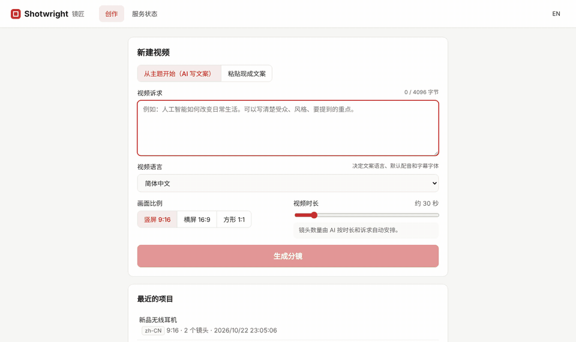
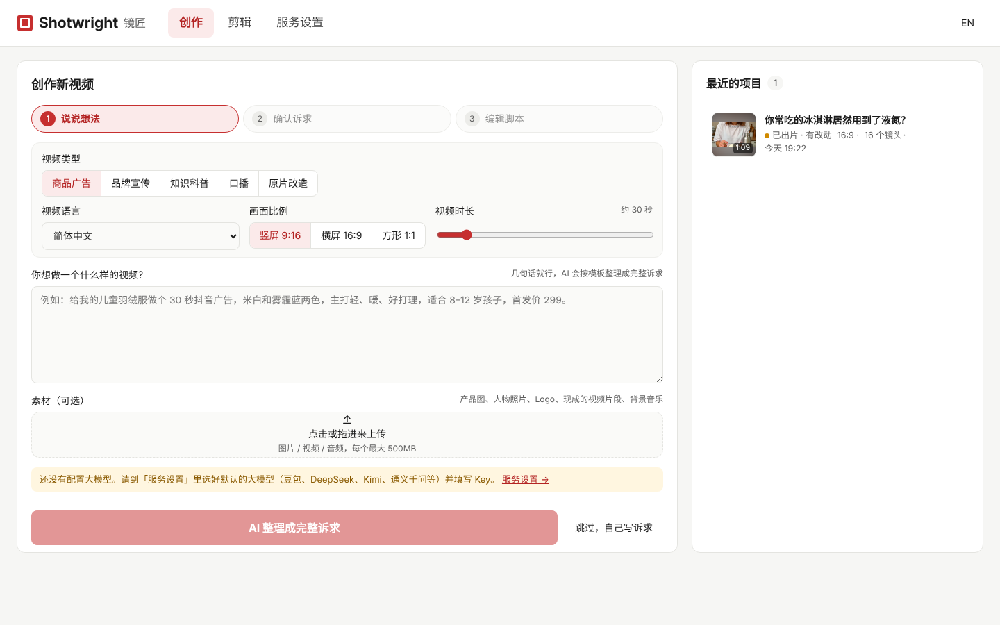
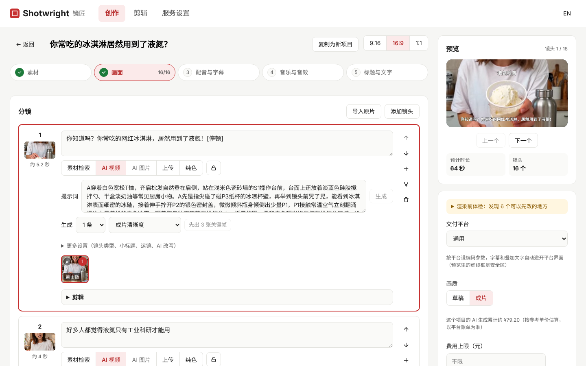
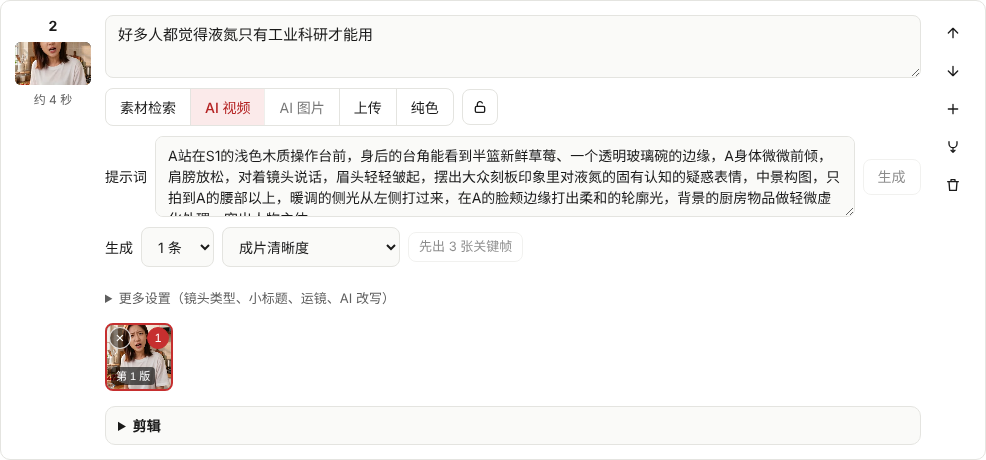
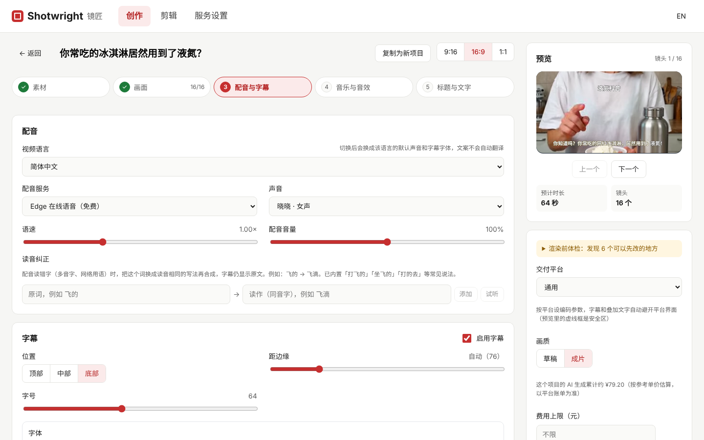
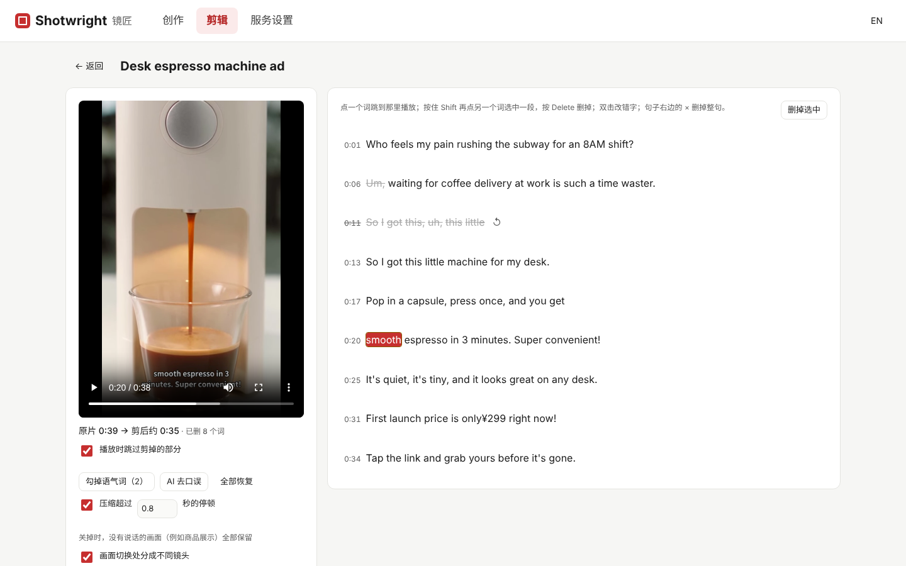
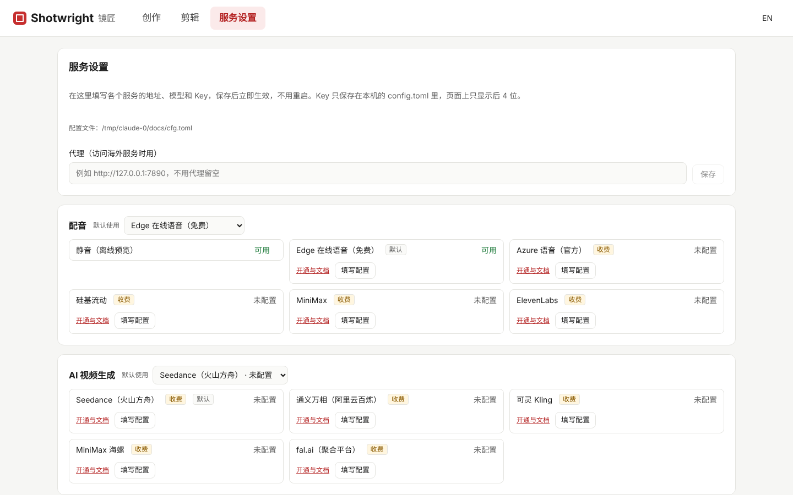

# Shotwright 镜匠

简体中文 | [English](README.en.md)

**从一段视频诉求到成片：AI 写文案、按分镜生成或检索画面、自动配音、字幕和背景音乐，每个镜头都可以单独调整。**

Shotwright 以"镜头"为核心：文案被拆成一个个镜头，每个镜头可以单独选择画面来源（素材库检索、AI 生成、上传图片或视频），可以替换、锁定、单独重做。改一个镜头，只会重新渲染这个镜头，再加上最后的拼接导出。

> 当前版本：v0.4.0。v0.4「商品广告」与「视频质量专项」的功能已全部开发完成，正在实测（改画面需要在方舟开通 Seedance 2.5）。v0.5「交付与效率」已完成界面配置服务、多家 AI 视频服务、剪辑页（按文字剪）和素材准备清单，其余在做。路线图见 [docs/ROADMAP.md](docs/ROADMAP.md)。



## 功能

- **人物、产品一致**：全片设定里每个主体可以上传照片，或让 AI 按外观描述生成一张纯色背景的定妆图；生成 AI 视频和图片时把这些图作为参考图，各镜头里是同一个人、同一件产品。一件产品有几种颜色时，每张图下写上颜色：镜头默认只用主图（不会把几种颜色一起交给模型），也可以在单个镜头里选用哪一款，提示词会要求颜色严格照着参考图；镜头里点名了几种颜色（如几个小朋友各穿一色）就带上这几款。「看图写外观」按参考图写出领型、有没有帽子、拉链口袋和缝线，提示词也要求款式结构照参考图，不让模型自己加帽子之类的部件。画面里有主体的镜头默认用 AI 生成，渲染前体检会提醒没有参考图的主体和用了素材库的镜头。
- **引导式新建**：先用几句话说想法，AI 按所选视频类型的模板整理成完整诉求（不知道的事实标成【待补充】让你填）；再按诉求写出逐段口播脚本，可以修改、调整顺序、增删段落；最后按定稿脚本生成分镜，文案一字不改。原始想法、视频诉求和分镜脚本会作为「创作记录」保存在项目里，编辑页可以随时查看、复制，或「以此为基础新建」：带着这些内容回到新建页，改完生成新的视频。新建时可以一起上传素材：产品图、人物照片进全片设定的主体图片，Logo 和风格图进主体库，视频片段直接放进镜头，音频作背景音乐。
- **分镜编辑**：按句子拆分镜头，或者写下视频诉求（受众、风格、要讲的重点，最多 4096 字节）并选好时长，让大模型写文案、自动决定镜头数，并给出检索词和画面提示词。已有的视频可以**复制成新项目**继续编辑，素材、设置和渲染缓存一起带走。
- **画面混用**：同一个视频里，有的镜头用 Pixabay / Pexels / Coverr 素材，有的用 AI 视频（Seedance、通义万相、可灵、MiniMax 海螺，或 fal.ai 上的 Veo、Vidu 等，每个镜头可以单独选用哪一家）或 AI 图片（Seedream + 慢推镜头），有的用自己上传的图片或视频。AI 图片还可以作为 AI 视频的首帧。一个镜头可以**多选几段素材按顺序播放**，候选素材也可以删掉。镜头下方会提示其他画面来源还有几个候选，点一下就能切过去，切换来源不会丢掉已经生成的素材。
- **剪辑已有视频**：顶部「剪辑」和「创作」分开，有自己的任务列表。有两种剪法：没有人说话的商品展示、空镜、混剪素材选「按画面剪」，不识别语音，按画面变化自动切成镜头，可以一次导入几段视频；口播、讲解、直播带货选「按说的话剪」：上传后自动识别说的话（本地 faster-whisper，免费、原片不出本机；也可以用 OpenAI 兼容的云端识别），识别页显示下载模型、识别的进度。在文稿里点词跳转播放，选中一段删掉，视频跟着剪；一键勾掉语气词（嗯、啊、um），「AI 去口误」找出重说、说一半放弃的句子，可以压缩超过几秒的停顿；双击改错字。剪好后生成原声分镜：不重新配音，字幕按识别出的逐词时间对齐，删掉的口误在镜头里直接跳过，之后照常加字幕样式、音乐、标题，也可以一键翻译出其他语言的配音版本。
- **原片导入与镜头内剪辑**：导入手机拍的原片，按画面变化自动切成镜头；每个镜头可以拖动选段（入点 / 出点）、拆分或合并。素材不够长时默认先慢放（不低于 0.8 倍）再定格最后一帧，不会跳回开头；原片的声音可以保留并调音量，有配音时自动压低；横竖屏互转时可以选取景位置，或用模糊背景完整保留主体。
- **视频质量**：首页按视频类型（商品广告、品牌宣传、知识科普、口播、原片改造）给诉求模板和写作提示，提交前检查没填的内容。写分镜时先定全片设定（主体外观、场景、风格、禁止项、调色），每个镜头有 60–120 词的画面描述、运镜和衔接说明，出稿自检不合格会重写一次；生成时可以先出关键帧、一次生成多条、配音过长时分段续生成；配置看图模型后自动检查产品是否走样、给素材排序、检查成片瑕疵；渲染前体检列出可以先改的地方。`shotwright bench` 跑质量基准集，和上一批对比。
- **成片加工**：导出时统一到 -14 LUFS 响度，背景音乐随配音自动闪避、开头淡入结尾淡出；可选让镜头切换点吸附到音乐节拍、加转场音效和环境声、全片统一调色、按交付平台（抖音 / 快手 / 视频号 / 小红书 / Shorts / Bilibili）编码并让字幕和叠加文字避开安全区。
- **商品广告**：项目级主体库（产品图、人物、Logo、风格图）作为生成参考；用提示词改画面（视频转视频）；卖点、价格、Logo 等文字与图形叠加和镜头转场；生成其他语言版本时叠加文字一起翻译。
- **收费确认**：所有收费生成都需要在界面上确认后才会提交；提交结果无法确认时不会自动重试，避免重复扣费。
- **增量渲染**：每个阶段按输入计算指纹并缓存，没改的镜头直接复用；渲染可以随时取消。草稿档用更快的编码先看效果；渲染前显示预计费用，项目里记录累计生成费用。
- **AI 内容标识**：成片的 MP4 元数据里写入 AI 生成标识和背景音乐署名（CC BY 曲目），也可以在画面上加「AI」角标。
- **配音**：默认用免费的 Edge 在线语音；也可以接入 Azure、硅基流动、MiniMax、ElevenLabs，在界面上直接切换服务和声音。
- **字幕**：按真实字体宽度自动换行、行长均衡。Edge 会返回逐词时间戳，字幕按实际读音对齐；其他配音服务不提供时间戳时，退回按字数比例分配。
- **读音纠正**：配音读错多音字或网络用语时（例如「打着飞的」的「的」），把词换成同音字再合成，字幕仍显示原文；可以试听，也可以让 AI 检查整篇文案里容易读错的词，常见说法已内置。
- **标题**：画面顶部的常驻大标题、片头标题卡（压暗画面、居中显示主副标题后淡出）、每个镜头的小标题，样式各自独立；还可以让 AI 按文案给出几个候选标题，点一下就能用。
- **文字样式**：字幕和标题都可以单独设置字体、加粗、倾斜、下划线、对齐、描边（可加第二层描边）、阴影（距离、方向、模糊）、底框、发光、字间距、行间距、不透明度，入场效果（淡入、弹出、上滑、逐字打出、卡拉 OK 逐字高亮）、出场效果（淡出、缩小消失、下滑淡出）和循环效果（呼吸缩放、左右摇摆）；字幕还能对关键词换色放大（手动填写或 AI 从文案里挑）。内置经典白字、综艺黄字、黑底白字、新闻条、霓虹发光、双层描边、立体投影、梦幻柔光等样式预设。内置思源黑体（常规 / 粗体）、思源宋体、站酷快乐体、站酷庆科黄油体、马善政毛笔楷书，也可以导入自己有授权的字体。
- **背景音乐**：可以自己上传（带封面的 mp4/m4a 也能直接当音乐用），也可以一键自动检索：大模型把视频诉求和镜头画面提炼成音乐风格检索词，从 Internet Archive（免 Key）找候选，按授权分类过滤，候选可以试听、切换，渲染时自动循环到整片时长。可选让镜头切换点吸附到音乐节拍上，还可以加转场音效和环境声。
- **素材检索缓存**：相同的检索词在 7 天内直接复用上次的结果，不重复请求素材库。
- **三种入口**：网页界面、REST API（`/api/v2`）、命令行，共用同一套服务和渲染队列。错误提示会按请求的语言返回中文或英文。
- **多语种**：视频可以是中文、英语、日语、韩语、西班牙语等 16 种语言，自动匹配配音声音和字幕字体；一个视频可以一键翻译出其他语言版本（画面共用，只换文案、配音和字幕）。网页界面支持中文 / English 切换。
- **素材分类存放**：项目素材按来源分到 `ai-video`、`ai-image`、`stock`、`upload`、`music` 等文件夹，旧项目启动时自动整理。
- **日志**：`storage/logs/shotwright.log` 记录收费任务的模型、任务 id 和结果，以及每次生成、渲染的过程，按天切分保留 14 天，API Key 自动脱敏。
- **离线可用**：不配置任何服务也能跑通（静音配音 + 纯色画面），方便先调分镜节奏。

## 界面

**创作新视频**：先用几句话说想法，AI 按视频类型的模板整理成完整诉求，再写出可以修改的逐段脚本，最后按脚本生成分镜；右侧是创作过的项目。



**分镜编辑**：按制作顺序分五步——① 素材（主体参考图、外观、品牌与风格参考）→ ② 画面 → ③ 配音与字幕 → ④ 音乐与音效 → ⑤ 标题与文字。素材清单里每个主体都备好参考图和外观并确认后，才能生成 AI 画面；之后改了设定会提示哪些镜头可能不一致。每个镜头单独选画面来源；右侧实时预览字幕效果，只重做有改动的镜头。



**镜头卡片**：每个镜头单独选画面来源（素材检索、AI 视频、AI 图片、上传、纯色），同一个视频可以混用；AI 视频按全片设定拼好提示词，可以先出关键帧、一次生成多条、选草稿或成片清晰度，每次生成都留一个版本；镜头类型、小标题、运镜和 AI 改写收在「更多设置」里。



**声音、字幕和语言版本**：切换视频语言和配音声音；背景音乐可以上传或自动检索，候选可试听；一键翻译出其他语言版本。



**剪辑已有视频**：「按说的话剪」识别出文稿后，点词跳到那里播放，划掉的是删掉的语气词和重说的句子，播放时直接跳过；剪好后生成原声分镜。没有人声的素材选「按画面剪」，直接按画面切镜头。



**服务设置**：在页面里填写各服务的 Key、模型和接口地址，保存即写回 `config.toml` 并立即生效；密钥只显示后 4 位，大模型、AI 视频和语音识别可以一键测试连接。



## 硬件要求

AI 写文案、AI 视频 / 图片和配音都在云端完成，本机只负责用 FFmpeg 剪辑合成，**不需要显卡**。

| | 最低配置 | 推荐配置 |
| --- | --- | --- |
| CPU | 2 核（x86-64 或 ARM64） | 4 核及以上 |
| 内存 | 2 GB 可用 | 8 GB |
| 磁盘 | 2 GB 可用（程序与依赖），另按每个项目 0.5 GB 预留 | 20 GB 以上 SSD |
| 网络 | 使用 AI、配音、素材检索时需要联网；离线模式可以不联网 | 稳定宽带，下载 1080p 素材更快 |
| 系统 | Windows 10 / 11、macOS 12+、主流 Linux 发行版 | |

实测参考（2 核 CPU、7 GB 内存的 Linux 云主机）：一条 6 个镜头、52.7 秒的 1080p 横屏视频，从头渲染约 2 分钟，服务和 FFmpeg 合计内存峰值不到 500 MB；只改一个镜头时只重做这个镜头、拼接和字幕合成，约 1 分钟（字幕合成需要重新编码整条视频）。在开发用的 Windows 台式机上，同样只改一个镜头的重新渲染实测 4–10 秒，CPU 核数越多越快。

磁盘主要被素材占用：一个用 AI 视频和 1080p 素材的项目实测 100–600 MB，每次渲染的成片约 15–20 MB/分钟。`cache/` 下的渲染缓存可以随时删除。

## 快速开始

需要 Python 3.11+、[FFmpeg](https://ffmpeg.org/download.html)（需带 libass，常见发行版都带）和 Node.js 20+（仅构建网页界面时需要）。

```bash
# 1. 安装后端
python -m venv .venv
.venv\Scripts\activate          # macOS / Linux：source .venv/bin/activate
pip install -e ".[dev,asr]"   # asr：剪辑页的本地语音识别（faster-whisper），不用剪辑可以去掉

# 2. 配置（可选）：复制模板后填写 Pixabay、大模型的 API Key
copy config.example.toml config.toml   # macOS / Linux：cp

# 3. 构建网页界面
cd web && npm install && npm run build && cd ..

# 4. 启动
shotwright serve
```

打开 <http://127.0.0.1:8000> 即可使用（加 `--open` 会自动打开浏览器）。8000 端口被其他程序占用或被系统保留时（Windows 上常见的 WinError 10013），会自动改用后面一个可用的端口，并在窗口里打印实际地址。Windows 上可以直接双击 `start.bat` 启动（自动打开浏览器）、双击 `restart.bat` 重启（会先关闭旧服务）。开发前端时可以另开终端运行 `cd web && npm run dev`，访问 <http://localhost:5173>。

### Docker

```bash
mkdir docker-data && cp config.example.toml docker-data/config.toml   # 按需填写 Key
docker compose up -d --build
```

打开 <http://127.0.0.1:8000>。项目和成片保存在 `docker-data/` 里。服务只放行本机地址访问；要在局域网里用，请在 `config.toml` 的 `[app]` 里把服务器 IP 加进 `allowed_hosts`，并把 `docker-compose.yml` 的端口改成 `"8000:8000"`。

### 命令行

```bash
shotwright new --script-file 文案.txt --aspect 9:16       # 按句拆成镜头
shotwright new --subject "人工智能如何改变日常生活" --llm --duration 45   # 让大模型写约 45 秒的文案并拆镜头
shotwright show <项目id>
shotwright shot <项目id> 2 --text "新的文案" --terms "city night,traffic"
shotwright render <项目id>                                # 只重做有改动的镜头
shotwright render <项目id> --allow-paid                   # 允许为缺画面的 AI 镜头调用收费生成
shotwright new --subject "AI in daily life" --llm --language en-US   # 生成英文视频
shotwright translate <项目id> ja-JP                        # 生成日语版本（新项目，画面共用）
shotwright copy <项目id>                                   # 复制成新项目继续编辑
shotwright bench                                           # 跑质量基准集，和上一批对比
```

## 配置

最简单的方式是在网页的「服务设置」页里填写：每个服务的 Key、模型和接口地址都可以直接改，保存后写回 `config.toml` 并立即生效，不用重启；大模型和 AI 视频服务还可以一键「测试连接」，确认 Key、地址和模型名是否正确。页面上 Key 只显示后 4 位。

也可以直接编辑配置文件，见 [config.example.toml](config.example.toml)（改完需要重启）。所有 Provider 字段也可以用环境变量覆盖，格式为 `SHOTWRIGHT_<类别>_<ID>_<字段>`，例如：

```bash
SHOTWRIGHT_STOCK_PIXABAY_API_KEY=xxxx
SHOTWRIGHT_DEFAULT_LLM=deepseek
SHOTWRIGHT_LLM_DEEPSEEK_API_KEY=sk-xxxx
```

大模型内置了豆包 Seed、DeepSeek、Kimi、通义千问四个预设，选好后只需填写 API Key；其他 OpenAI 兼容接口用 `openai` 小节自定义 Base URL 和模型。

配音默认用免 Key 的 Edge 在线语音。需要更稳定的音质或商用授权时，可以在 `[defaults]` 里把 `tts` 换成 `azure`、`siliconflow`、`minimax` 或 `elevenlabs`，再在对应小节填写 API Key（这几家均为收费服务，界面上会标出"收费"）。

素材库默认用 Pixabay。Pexels 需要自己的 Key；Coverr 免 Key，素材以横屏为主。

剪辑页的语音识别默认用本地 `faster_whisper`：不联网、不收费，原片不出本机。第一次识别时会下载模型（`small` 约 480MB），连不上 Hugging Face 时自动换用 hf-mirror.com 镜像。想改用云端识别，就在 `[defaults]` 里把 `asr` 换成 `openai` 并填好 `[providers.asr.openai]`：任何 OpenAI 兼容、能返回逐词时间戳的 `/audio/transcriptions` 接口都可以（OpenAI 的 `whisper-1`、Groq 的 `whisper-large-v3-turbo` 等），单个文件不超过 25MB。

背景音乐检索默认用 Internet Archive，不需要 Key。**Archive 上的音频授权不一**：有的禁止商用或改编（例如 CC BY-NC-ND），有的没有标注授权。检索结果会按授权分类，非商用授权的曲目直接跳过；未标注授权的默认保留并在界面上标出"未标注授权"，发布前请自行确认。需要更严格时，可以在 `[providers.music.archive]` 里把 `allow_unknown_license` 设为 `"false"`，只保留明确可商用的授权（CC0 / 公共领域 / CC BY / CC BY-SA），或者用 `collection` 限定在授权明确的合集，也可以直接上传自己的音乐。

AI 视频（Seedance）和 AI 图片（Seedream）与豆包同属火山方舟，填好 `[providers.llm.doubao]` 的 Key 并在方舟控制台开通对应模型即可使用，不需要再填一遍。

其他 AI 视频服务（通义万相、可灵、MiniMax 海螺、fal.ai）在 `config.toml` 里各有一节，填上 Key 就能用，示例见 `config.example.toml`。配好几家时，镜头的提示词旁边会出现「视频模型」选择，可以同一个镜头用不同模型各生成一条对比。每家的模型能力（时长档位、分辨率、能否用参考图）都写在代码里：支持参考图的模型（Seedance 2.x、万相 3.0、MiniMax H3）把商品图作为参考图提交，不支持的把第一张商品图作为首帧。单价是参考价，用 `price` 填上自己账户的实际单价后，费用估算和预算控制会更准。

密钥只保存在配置文件或环境变量中，不会写进项目文件，项目文件可以放心分享。

## 文档

- [架构说明](docs/ARCHITECTURE.md)：分层、数据模型、渲染流水线、Provider 插件
- [路线图](docs/ROADMAP.md)
- [参考 MoneyPrinterTurbo 的移植清单](docs/PORTING.md)
- [如何新增一个 Provider](docs/PROVIDERS.md)

## 致谢

Shotwright 是一个全新编写的项目，部分设计和实现参考了 [MoneyPrinterTurbo](https://github.com/harry0703/MoneyPrinterTurbo)（MIT License，© 2024 Harry），具体见 [NOTICE.md](NOTICE.md)。

## 许可证

[MIT](LICENSE)。内置字体（Noto Sans SC / KR / Thai、Noto Serif SC、站酷快乐体、站酷庆科黄油体、马善政毛笔楷书）均使用 SIL Open Font License 1.1，可免费商用（见 [resources/fonts](resources/fonts)）。
