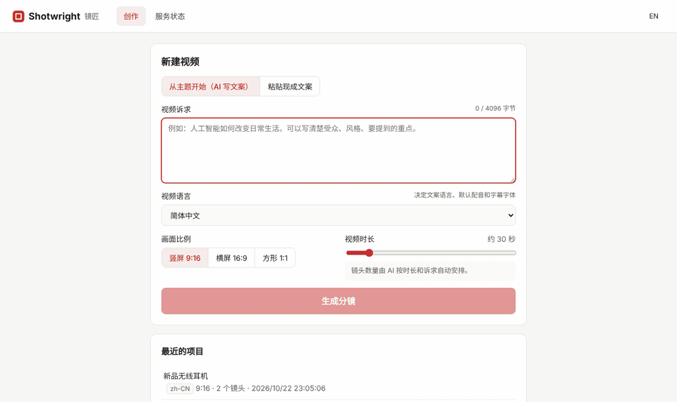
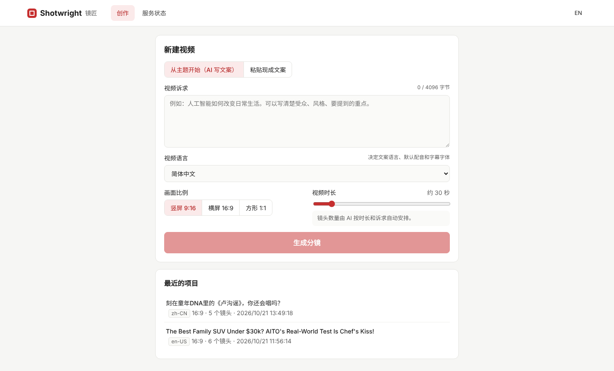
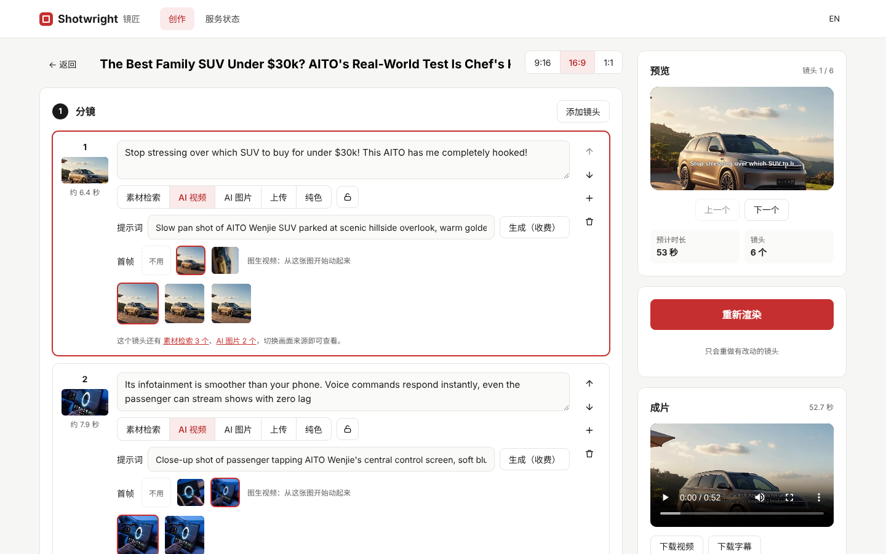
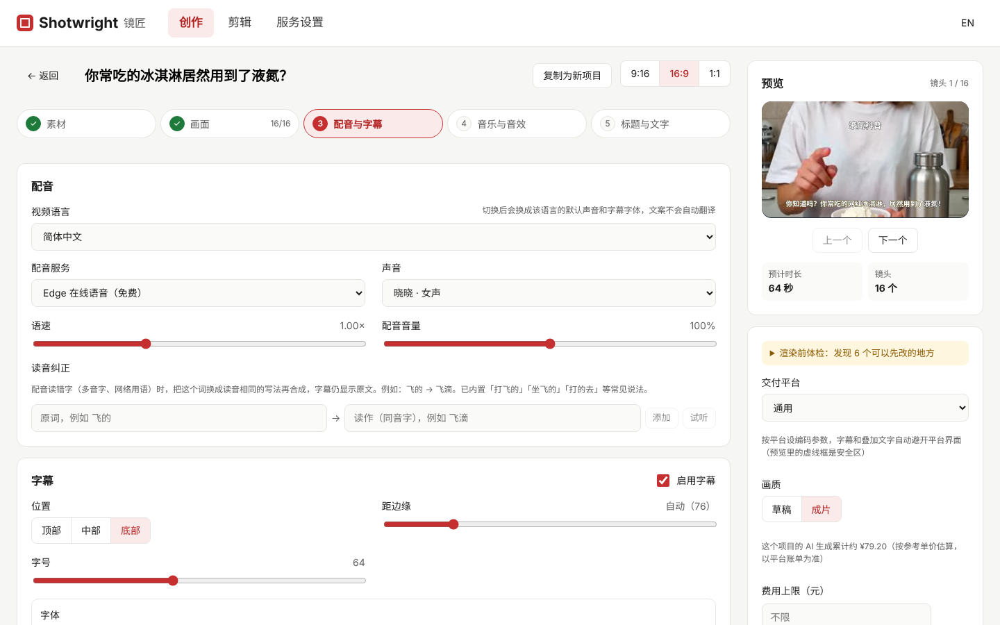
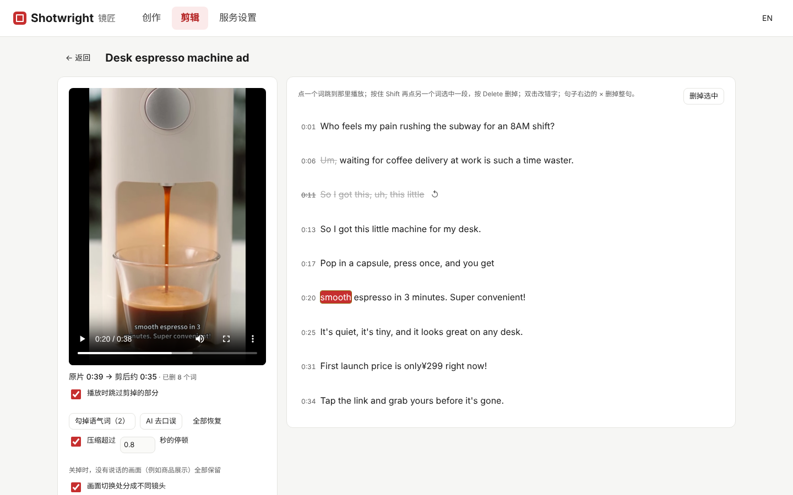
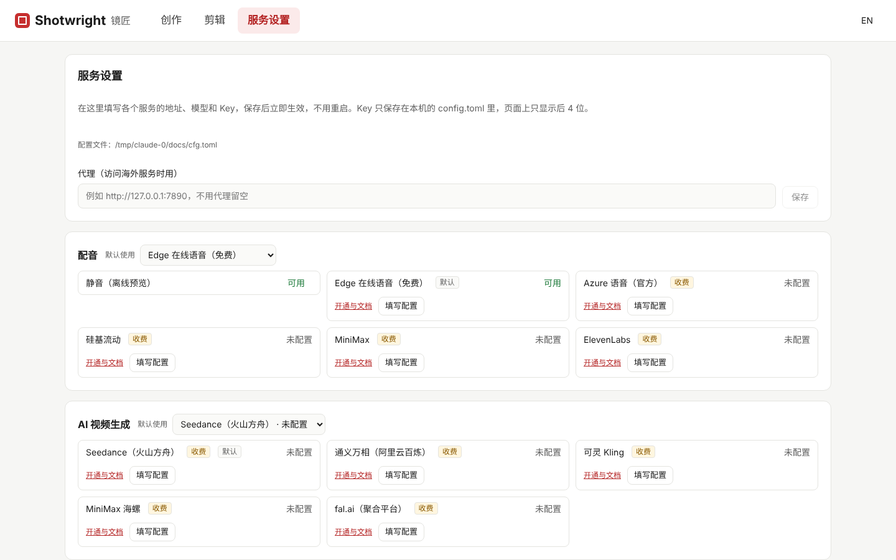

# Shotwright 镜匠

简体中文 | [English](README.en.md)

**一份脚本，变成一组能投放的广告。**

开源、在自己电脑上运行的 AI 短视频工具：脚本自动拆成镜头，每个镜头单独选画面（素材库、AI 视频、AI 图片或自己拍的），配音、字幕、背景音乐自动完成；改哪个镜头只重做哪个镜头，花钱前先检查，每笔花费都看得见，一键出多种语言版本。

Shotwright 以"镜头"为核心：文案被拆成一个个镜头，每个镜头可以单独选择画面来源（素材库检索、AI 生成、上传图片或视频），可以替换、锁定、单独重做。改一个镜头，只会重新渲染这个镜头，再加上最后的拼接导出。

> 当前版本：v0.5.1。v0.4「商品广告」与「视频质量专项」的功能已全部开发完成，正在实测（用提示词改画面需要支持视频改视频的模型，如 Seedance 2.5）。v0.5「交付与效率」已完成首次启动向导、界面配置服务、多家 AI 视频服务、剪辑页、审片页、关键帧默认先行、生成前检查、整片样片、单镜头花费上限、品牌包与主体库、Windows 安装包（桌面窗口、国内下载加速）、示例项目和免费大模型（智谱 GLM-4.7-Flash、本地 Ollama），其余在做。路线图见 [docs/ROADMAP.md](docs/ROADMAP.md)。

**⬇️ Windows 一键安装：[下载 Shotwright-setup.exe](https://github.com/rushansishui/Shotwright/releases/latest/download/Shotwright-setup.exe)**（Windows 10 / 11 64 位，双击安装，不用另装任何环境）· [所有版本](https://github.com/rushansishui/Shotwright/releases)

国内下载慢可以用加速地址：[加速 1](https://gh-proxy.com/https://github.com/rushansishui/Shotwright/releases/latest/download/Shotwright-setup.exe) · [加速 2](https://ghfast.top/https://github.com/rushansishui/Shotwright/releases/latest/download/Shotwright-setup.exe)（第三方公益服务，打不开就换一个；每个版本的 Release 页面附有 SHA256，可以核对文件）。装好打开后点「打开示例项目」，不用配置任何 Key 就能先渲染出一条成片看看效果。



<!-- 成片示例：放 2–3 条用 Shotwright 做的成片（建议 15–30 秒、竖屏、中英文各一条）。
     做法：在 GitHub 网页上编辑本文件，把 mp4 拖进编辑框，会生成一行 https://github.com/user-attachments/assets/... 链接，
     把链接放在下面这一行的位置，GitHub 会直接显示成播放器。 -->
https://github.com/user-attachments/assets/d5c31019-7dd6-4d9d-b19d-2018426eb109

https://github.com/user-attachments/assets/ca6040ec-a1a7-4bac-be09-4c2d36f1069c


**改一个镜头，只重渲这个镜头。** 12 个镜头、50 秒成片：整片首次渲染 **21 秒**；改一句文案后重渲 **11 秒**，只重渲 **1/12** 个镜头，26 个渲染阶段复用 22 个。这是渲染引擎按镜头缓存的结果，不是参数调优——数字和复现命令见 [BENCHMARK.md](BENCHMARK.md)。

**一条命令跑起来：**

```bash
git clone https://github.com/rushansishui/Shotwright.git && cd Shotwright
pip install -e ".[dev]" && shotwright serve --open
```

不填任何 Key 也能先出一条片（示例项目 + 免费素材 + Edge 配音），确认好用再填模型 Key。

## 和同类工具比

| | Shotwright | [ClipForge](https://github.com/xixihhhh/clipforge) | [Pixelle-Video](https://github.com/AIDC-AI/Pixelle-Video) | [LibTV](https://liblib.tv/) | [即梦（含小云雀）](https://jimeng.jianying.com/) | [剪映](https://www.capcut.cn/) |
|---|---|---|---|---|---|---|
| 形式 | 开源（MIT），本地运行 | 开源（AGPL-3.0），本地运行，约 1.3k Star | 开源（Apache 2.0），本地运行，约 30.1k Star | 在线平台 | 在线平台 / App | App / 桌面端 |
| 擅长 | 按脚本做商品广告、宣传短片，也能剪已有视频 | 上传商品图一键出带货视频，也支持一句话成片 | 输入主题，自动写文案、配图或生成视频、出片 | 在无限画布上用节点搭工作流，做短剧、漫剧、广告 | 一句话生成短视频，商品图生成带货场景，爆款复刻 | 手动剪辑，加图文成片、AI 字幕配音、数字人等 |
| 画面来源 | 素材库、AI 视频、AI 图片、自己拍的，每个镜头单独选 | 免费素材、本地素材库、AI 图片和视频，内置 391 个模板 | AI 图片和视频为主，也能上传自己的照片、视频 | 平台接入的图片、视频模型生成 | 平台自家模型生成，可结合实拍 | 自己的素材 |
| 模型 | 文字、图片、视频、配音都可以换不同厂家 | 30 多个精选模型，可换不同厂家 | 多种大模型和配音，可接 ComfyUI、RunningHub 工作流 | 平台接入的多家主流模型 | 平台自家模型 | 平台内置 |
| 改一个镜头 | 只重做这个镜头，其余复用 | 每个镜头保留候选版本，单独重做坏的一段 | — | 在画布上单独重做某个节点 | — | Hub 里可单独重生成一个分镜，或时间线手动改 |
| 配音、字幕、音乐到成片 | 同一流程里自动完成 | 自动完成 | 自动完成 | 要自己在画布上搭 | 自动完成 | 手动或用 AI 功能逐项加 |
| 花钱前 | 检查容易翻车的描述，列出每个镜头的预计费用，可设单镜头花费上限 | — | — | — | — | — |
| 多语言版本 | 一键翻译出其他语言版本，画面共用 | 可出英文配音版本 | — | — | — | — |
| 怎么用 | 网页界面、REST API、命令行，Windows 安装包 | 网页、桌面版、Docker、命令行、MCP | Windows 一键整合包、Docker | 打开网页即用 | 打开网页或 App 即用 | 安装 App 即用 |
| 花费 | 用自己的 API Key，每笔花费有记录 | 用自己的 API Key，也能只用免费素材和免费配音 | 用自己的 API Key 或本地 ComfyUI | 积分制，有年卡 | 积分制，有会员 | 基础功能免费，部分功能需会员 |
| 项目和素材 | 存在自己电脑上 | 存在自己电脑上 | 存在自己电脑上 | 在平台上 | 在平台上 | 本地或云空间 |

> 2026 年 9 月剪映发布 **剪映 Hub**：无限画布 + 多轨剪辑，从一句话 / 文档生成分镜脚本、批量出分镜提示词、调用 Seedance 等多模型生成，再进时间线精修（[介绍](https://baike.baidu.com/item/%E5%89%AA%E6%98%A0Hub/69134075)）。它是和 Shotwright 主链路最接近的产品，差别在：绑定字节系模型、数据和账号在云端、按积分计费；Shotwright 开源、本地、可换模型、能算清每条片的成本。
>
> 表里没单列的邻接项目：**MoneyPrinterTurbo**（14.3 万星，主题 → 批量混剪，不做镜头级控制）和 **NarratoAI**（1.18 万星，影视解说 + 自动剪辑），解决的问题和 Shotwright 不同，放在下面的「怎么选」里说。

怎么选：只有商品图、想最快出一批带货视频，ClipForge 的模板很多；输入主题自动出图文或 AI 视频，可以看 Pixelle-Video；想在画布上自由搭工作流、做短剧和长片，可以看 LibTV；想一句话直接出片、不折腾配置，即梦、剪映更省事；要按主题批量混剪素材库视频，有 [MoneyPrinterTurbo](https://github.com/harry0703/MoneyPrinterTurbo)；给已有视频配 AI 解说，[NarratoAI](https://github.com/linyqh/NarratoAI) 更合适。要按脚本做出能投放的广告，逐个镜头把控画面、花钱前心里有数、一键出多语言版本、项目留在自己手里，用 Shotwright。

<sub>以上信息整理自各项目主页、GitHub 页面和公开资料，截至 2026 年 11 月 16 日；Star 数为 GitHub API 当天的快照。「—」表示没有找到公开说明，不代表一定没有。产品更新很快，如有不准欢迎提 issue 指正。</sub>

## 核心能力

- **镜头级控制**：每个镜头单独选画面来源（素材库 / AI 视频 / AI 图片 / 上传 / 纯色），可替换、锁定、单独重做；改一个镜头只重渲这个镜头，不重做整片。
- **花钱前心里有数**：生成前检查、整片样片、单镜头花费上限、渲染前费用预估；花完给一张花费回执——每秒成片花费、首次可用率、平均重做次数、浪费金额。
- **实拍与 AI 混剪**：同一个片子里混用素材库、AI 生成和自己拍的；导入原片按画面切片，口播按文字精剪（本地语音识别，原片不出本机）。
- **一键多语言版本**：同一套画面，翻译成 16 种语言的文案、配音和字幕，一次出多个投放版本。
- **模型中立**：文字、图片、视频、配音都可以换不同厂家，用你自己的 Key，不绑定任何一家，也不会因为某家涨价就停工。
- **本地运行、数据自己拿着**：MIT 开源，项目、素材、日志都在自己电脑上；不填任何 Key 也能先跑通。

完整功能清单（30 条，含边界情况和每个按钮的行为）见 [docs/FEATURES.md](docs/FEATURES.md)。

## 界面

**创作新视频**：先用几句话说想法，AI 按视频类型的模板整理成完整诉求，再写出可以修改的逐段脚本，最后按脚本生成分镜；右侧是创作过的项目。



**分镜编辑**：按制作顺序分五步——① 素材（主体参考图、外观、品牌与风格参考）→ ② 画面 → ③ 配音与字幕 → ④ 音乐与音效 → ⑤ 标题与文字。素材清单里每个主体都备好参考图和外观并确认后，才能生成 AI 画面；之后改了设定会提示哪些镜头可能不一致。每个镜头单独选画面来源；右侧实时预览字幕效果，只重做有改动的镜头。



**镜头卡片**：每个镜头单独选画面来源（素材检索、AI 视频、AI 图片、上传、纯色），同一个视频可以混用；AI 视频按全片设定拼好提示词，可以先出关键帧、一次生成多条、选草稿或成片清晰度，每次生成都留一个版本；镜头类型、小标题、运镜和 AI 改写收在「更多设置」里。


**声音、字幕和语言版本**：切换视频语言和配音声音；背景音乐可以上传或自动检索，候选可试听；一键翻译出其他语言版本。



**剪辑已有视频**：「按说的话剪」识别出文稿后，点词跳到那里播放，划掉的是删掉的语气词和重说的句子，播放时直接跳过；剪好后生成原声分镜。没有人声的素材选「按画面剪」，直接按画面切镜头。



**服务设置**：在页面里填写各服务的 Key、模型和接口地址，保存即写回 `config.toml` 并立即生效；密钥只显示后 4 位，大模型、AI 视频和语音识别可以一键测试连接。



## 硬件要求

AI 写文案、AI 视频 / 图片和配音都在云端完成，本机只负责用 FFmpeg 剪辑合成，**不需要显卡**。

| | 最低配置 | 推荐配置 |
| --- | --- | --- |
| CPU | 2 核（x86-64 或 ARM64） | 4 核及以上 |
| 内存 | 2 GB 可用 | 8 GB |
| 磁盘 | 2 GB 可用（程序与依赖），另按每个项目 0.5 GB 预留 | 20 GB 以上 SSD |
| 网络 | 使用 AI、配音、素材检索时需要联网；离线模式可以不联网 | 稳定宽带，下载 1080p 素材更快 |
| 系统 | Windows 10 / 11、macOS 12+、主流 Linux 发行版 | |

实测参考（2 核 CPU、7 GB 内存的 Linux 云主机）：一条 6 个镜头、52.7 秒的 1080p 横屏视频，从头渲染约 2 分钟，服务和 FFmpeg 合计内存峰值不到 500 MB；只改一个镜头时只重做这个镜头、拼接和字幕合成，约 1 分钟（字幕合成需要重新编码整条视频）。在开发用的 Windows 台式机（16 核）上跑 `shotwright bench --local`：12 个镜头、50 秒成片，整片首次渲染约 21 秒，改一个镜头后约 11 秒，只重渲 1 个镜头——数字和复现方式见 [BENCHMARK.md](BENCHMARK.md)。CPU 核数越多越快。

磁盘主要被素材占用：一个用 AI 视频和 1080p 素材的项目实测 100–600 MB，每次渲染的成片约 15–20 MB/分钟。`cache/` 下的渲染缓存可以随时删除。

## 快速开始

**Windows 安装包**：[下载最新版 Shotwright-setup.exe](https://github.com/rushansishui/Shotwright/releases/latest/download/Shotwright-setup.exe)（或在 [Releases](https://github.com/rushansishui/Shotwright/releases/latest) 页面下载带版本号的 `Shotwright-<版本>-setup.exe`），双击安装，不需要管理员权限，也不用另装 Python、Node.js 和 FFmpeg（都已打包在内）。装好后从开始菜单或桌面图标打开，界面显示在独立的桌面窗口里（用系统自带的 WebView2，Windows 11 自带，Windows 10 一般随 Edge 更新已装好），关掉窗口就停止服务；电脑上没有 WebView2 时自动改用浏览器打开。想用自己的浏览器时，从开始菜单的「Shotwright (Browser)」打开。配置、项目和日志放在 `%LOCALAPPDATA%\Shotwright`（开始菜单里的「Shotwright Data」），卸载和升级都不会删掉。遇到问题可以在命令行运行 `Shotwright.exe doctor` 检查环境。

> 安装包暂未做代码签名，双击时 Windows 可能提示「Windows 已保护你的电脑」：点「更多信息」→「仍要运行」即可。

发布新版本（维护者）：把 `pyproject.toml` 和 `web/package.json` 里的版本号改成一样的新版本并推到 `main`，然后 `git tag v<版本>` 再 `git push origin v<版本>`。GitHub Actions 会先检查标签和两处版本号是否一致，再自动打包、安装测试，并把安装包附到 Release 上，上面的下载链接自动指向最新版。想要国内镜像直链时，在仓库的 Actions 设置里配好兼容 S3 的对象存储（腾讯云 COS、阿里云 OSS 等，见 `.github/workflows/release-windows.yml` 里「Upload to China mirror」一步的说明），发版时会自动上传，Release 说明里会带上国内地址。

自己打包：在仓库根目录运行 `powershell -ExecutionPolicy Bypass -File scripts\build-installer.ps1`（需要 Python 3.11+、Node.js 20+ 和 [Inno Setup 6.5+](https://jrsoftware.org/isdl.php)；FFmpeg 会自动下载固定版本并校验），安装包输出到 `dist\installer\`。

**Windows 从源码运行**：装好 Python 3.11+、FFmpeg 和 Node.js（`start.bat` 缺哪个会提示对应的 `winget` 安装命令），双击 `start.bat`。第一次启动会自动建虚拟环境、装依赖、构建网页界面并打开浏览器。

**不填任何 Key 也能用**：首页会出现「开始之前」引导。可以任选一家大模型服务（豆包、DeepSeek、Kimi、通义千问，或任何 OpenAI 兼容接口）填上 Key，也可以先免费试试：自己写口播脚本，配上免费的 Edge 配音、字幕和你上传的图片、视频；或者剪辑已有视频（本地语音识别）。素材库没填 Key 时自动改用免 Key 的 Coverr。

手动安装需要 Python 3.11+、[FFmpeg](https://ffmpeg.org/download.html)（需带 libass，常见发行版都带）和 Node.js 20+（仅构建网页界面时需要）。

```bash
# 1. 安装后端
python -m venv .venv
.venv\Scripts\activate          # macOS / Linux：source .venv/bin/activate
pip install -e ".[dev,asr]"   # asr：剪辑页的本地语音识别（faster-whisper），不用剪辑可以去掉

# 2. 配置（可选）：复制模板后填写 Pixabay、大模型的 API Key
copy config.example.toml config.toml   # macOS / Linux：cp

# 3. 构建网页界面
cd web && npm install && npm run build && cd ..

# 4. 启动
shotwright serve
```

打开 <http://127.0.0.1:8000> 即可使用（加 `--open` 会自动打开浏览器）。8000 端口被其他程序占用或被系统保留时（Windows 上常见的 WinError 10013），会自动改用后面一个可用的端口，并在窗口里打印实际地址。Windows 上可以直接双击 `start.bat` 启动（自动打开浏览器）、双击 `restart.bat` 重启（会先关闭旧服务）。开发前端时可以另开终端运行 `cd web && npm run dev`，访问 <http://localhost:5173>。

### Docker

```bash
mkdir docker-data && cp config.example.toml docker-data/config.toml   # 按需填写 Key
docker compose up -d --build
```

打开 <http://127.0.0.1:8000>。项目和成片保存在 `docker-data/` 里。服务只放行本机地址访问；要在局域网里用，请在 `config.toml` 的 `[app]` 里把服务器 IP 加进 `allowed_hosts`，并把 `docker-compose.yml` 的端口改成 `"8000:8000"`。

### 命令行

```bash
shotwright new --script-file 文案.txt --aspect 9:16       # 按句拆成镜头
shotwright new --subject "人工智能如何改变日常生活" --llm --duration 45   # 让大模型写约 45 秒的文案并拆镜头
shotwright show <项目id>
shotwright shot <项目id> 2 --text "新的文案" --terms "city night,traffic"
shotwright render <项目id>                                # 只重做有改动的镜头
shotwright render <项目id> --allow-paid                   # 允许为缺画面的 AI 镜头调用收费生成
shotwright new --subject "AI in daily life" --llm --language en-US   # 生成英文视频
shotwright translate <项目id> ja-JP                        # 生成日语版本（新项目，画面共用）
shotwright copy <项目id>                                   # 复制成新项目继续编辑
shotwright spend <项目id>                                  # 花费回执：每个镜头花了多少、哪几版白花了
shotwright bench                                           # 跑质量基准集，和上一批对比
shotwright bench --local                                   # 本地渲染基准：不联网、不花钱，测改一个镜头要多久
```

## 配置

最简单的方式是在网页的「服务设置」页里填写：每个服务的 Key、模型和接口地址都可以直接改，保存后写回 `config.toml` 并立即生效，不用重启；大模型和 AI 视频服务还可以一键「测试连接」，确认 Key、地址和模型名是否正确。页面上 Key 只显示后 4 位。

也可以直接编辑配置文件，见 [config.example.toml](config.example.toml)（改完需要重启）。所有 Provider 字段也可以用环境变量覆盖，格式为 `SHOTWRIGHT_<类别>_<ID>_<字段>`，例如：

```bash
SHOTWRIGHT_STOCK_PIXABAY_API_KEY=xxxx
SHOTWRIGHT_DEFAULT_LLM=deepseek
SHOTWRIGHT_LLM_DEEPSEEK_API_KEY=sk-xxxx
```

大模型内置了豆包 Seed、DeepSeek、Kimi、通义千问四个预设，选好后只需填写 API Key；其他 OpenAI 兼容接口用 `openai` 小节自定义 Base URL 和模型。

配音默认用免 Key 的 Edge 在线语音。需要更稳定的音质或商用授权时，可以在 `[defaults]` 里把 `tts` 换成 `azure`、`siliconflow`、`minimax` 或 `elevenlabs`，再在对应小节填写 API Key（这几家均为收费服务，界面上会标出"收费"）。

素材库默认用 Pixabay（免费申请 Key）；没填 Key 时自动改用免 Key 的 Coverr（素材以横屏为主）。Pexels 需要自己的 Key。服务设置页里每个服务都写了「怎么开通」：去哪里注册、拿哪个 Key、要开通什么、怎么收费。

剪辑页的语音识别默认用本地 `faster_whisper`：不联网、不收费，原片不出本机。第一次识别时会下载模型（`small` 约 480MB），连不上 Hugging Face 时自动换用 hf-mirror.com 镜像。想改用云端识别，就在 `[defaults]` 里把 `asr` 换成 `openai` 并填好 `[providers.asr.openai]`：任何 OpenAI 兼容、能返回逐词时间戳的 `/audio/transcriptions` 接口都可以（OpenAI 的 `whisper-1`、Groq 的 `whisper-large-v3-turbo` 等），单个文件不超过 25MB。

背景音乐检索默认用 Internet Archive，不需要 Key。**Archive 上的音频授权不一**：有的禁止商用或改编（例如 CC BY-NC-ND），有的没有标注授权。检索结果会按授权分类，非商用授权的曲目直接跳过；未标注授权的默认保留并在界面上标出"未标注授权"，发布前请自行确认。需要更严格时，可以在 `[providers.music.archive]` 里把 `allow_unknown_license` 设为 `"false"`，只保留明确可商用的授权（CC0 / 公共领域 / CC BY / CC BY-SA），或者用 `collection` 限定在授权明确的合集，也可以直接上传自己的音乐。

AI 视频（Seedance）和 AI 图片（Seedream）与豆包同属火山方舟，填好 `[providers.llm.doubao]` 的 Key 并在方舟控制台开通对应模型即可使用，不需要再填一遍。

其他 AI 视频服务（通义万相、可灵、MiniMax 海螺、fal.ai）在 `config.toml` 里各有一节，填上 Key 就能用，示例见 `config.example.toml`。配好几家时，镜头的提示词旁边会出现「视频模型」选择，可以同一个镜头用不同模型各生成一条对比。每家的模型能力（时长档位、分辨率、能否用参考图）都写在代码里：支持参考图的模型（Seedance 2.x、万相 3.0、MiniMax H3）把商品图作为参考图提交，不支持的把第一张商品图作为首帧。单价是参考价，用 `price` 填上自己账户的实际单价后，费用估算和预算控制会更准。

密钥只保存在配置文件或环境变量中，不会写进项目文件，项目文件可以放心分享。

## 文档

- [架构说明](docs/ARCHITECTURE.md)：分层、数据模型、渲染流水线、Provider 插件
- [渲染基准](BENCHMARK.md)：改一个镜头只重渲一个镜头的实测数据与复现方式
- [完整功能清单](docs/FEATURES.md)：30 条功能的细节和边界情况
- [参与开发](CONTRIBUTING.md)：环境、测试、改动规范
- [路线图](docs/ROADMAP.md)
- [参考 MoneyPrinterTurbo 的移植清单](docs/PORTING.md)
- [如何新增一个 Provider](docs/PROVIDERS.md)

## 开发脚本

`scripts/` 下是开发时用的辅助脚本，不随安装包分发：

- `scripts/promo/`：一条命令做宣传片。复制一个做好的演示项目，建一个 16:9 的项目放口播，
  用 Playwright 自动操作界面并录屏（会花钱的按钮只把鼠标移上去、不点），录完按配音时长
  对齐、剪掉等待、放回镜头，最后渲染成片。分镜和口播在 `storyboard.py` 里改。
  先装依赖：`pip install -e ".[promo]" && python -m playwright install chromium`，
  然后 `python scripts/promo/make_promo.py --demo <项目id> --lang zh`。
- `scripts/build-installer.ps1`：在 Windows 上打安装包（见「快速开始」）。

## 致谢

Shotwright 是一个全新编写的项目，部分设计和实现参考了 [MoneyPrinterTurbo](https://github.com/harry0703/MoneyPrinterTurbo)（MIT License，© 2024 Harry），具体见 [NOTICE.md](NOTICE.md)。

## 许可证

[MIT](LICENSE)。内置字体（Noto Sans SC / KR / Thai、Noto Serif SC、站酷快乐体、站酷庆科黄油体、马善政毛笔楷书）均使用 SIL Open Font License 1.1，可免费商用（见 [resources/fonts](resources/fonts)）。

